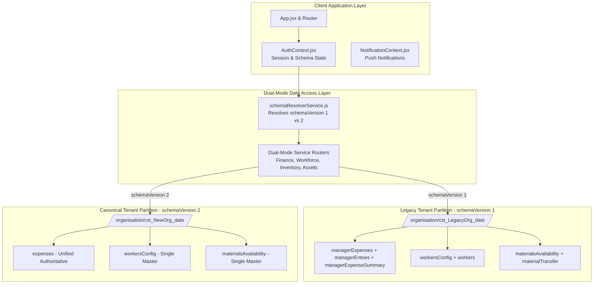
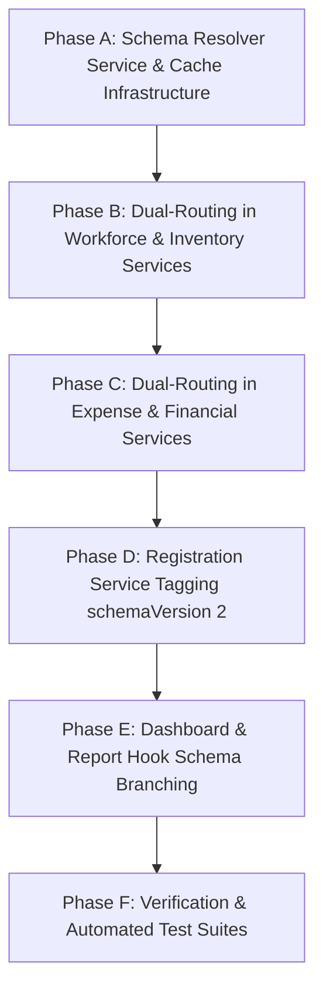

# eBricks: Production-Safe Dual Firestore Architecture Specification & Implementation Plan

**Project:** eBricks — Construction & Operations Management Platform  
**Target Environment:** Production Live Environment (4 Active Enterprise Tenants)  
**Document Version:** 1.0.0  
**Status:** PROPOSED & AWAITING USER APPROVAL (Zero Code/Database Changes Executed)  
**Execution Safety:** 100% Backward Compatible; No In-Place Migration of Existing Organizations; Zero Legacy Collection Deletion

---

## Table of Contents
1. [Executive Summary & Core Architectural Contract](#1-executive-summary--core-architectural-contract)
2. [Phase 1: Codebase Architecture & Data Access Points Analysis](#2-phase-1-codebase-architecture--data-access-points-analysis)
   - [2.1 Project Architecture & Module Topology](#21-project-architecture--module-topology)
   - [2.2 Organization Tenancy & Identification Strategy](#22-organization-tenancy--identification-strategy)
   - [2.3 Multi-Tenant Isolation & Authentication Boundary](#23-multi-tenant-isolation--authentication-boundary)
3. [Phase 2: Complete Firestore Usage & Dependency Matrix](#3-phase-2-complete-firestore-usage--dependency-matrix)
   - [2.1 Comprehensive Collection Dependency Matrix](#31-comprehensive-collection-dependency-matrix)
   - [2.2 Data Responsibility Classification](#32-data-responsibility-classification)
   - [2.3 Legacy Discrepancies, Mirrored Writes & Stale Reads](#33-legacy-discrepancies-mirrored-writes--stale-reads)
4. [Phase 3: Approved Canonical Firestore Structure Analysis](#4-phase-3-approved-canonical-firestore-structure-analysis)
   - [4.1 Canonical Schema Hierarchy & Namespace Specification](#41-canonical-schema-hierarchy--namespace-specification)
   - [4.2 Entity-by-Entity Schema Definition & Document ID Strategy](#42-entity-by-entity-schema-definition--document-id-strategy)
   - [4.3 Authoritative Single-Collection Expenses Specification](#43-authoritative-single-collection-expenses-specification)
   - [4.4 Subscription Single Source of Truth Validation](#44-subscription-single-source-of-truth-validation)
5. [Phase 4: Comprehensive Implementation Plan](#5-phase-4-comprehensive-implementation-plan)
   - [5.1 Summary of Architectural Findings](#51-summary-of-architectural-findings)
   - [5.2 Old-to-New Collection Mapping Matrix](#52-old-to-new-collection-mapping-matrix)
   - [5.3 File-Level Implementation Plan](#53-file-level-implementation-plan)
   - [5.4 Risk Assessment & Mitigation Matrix](#54-risk-assessment--mitigation-matrix)
   - [5.5 Phased Execution Strategy (Phases A through E)](#55-phased-execution-strategy-phases-a-through-e)
   - [5.6 Regression, Concurrency & Dual-Mode Testing Strategy](#56-regression-concurrency--dual-mode-testing-strategy)
   - [5.7 Production Rollout & Rollback Procedures](#57-production-rollout--rollback-procedures)
6. [Approval Gate & Questions for User Alignment](#6-approval-gate--questions-for-user-alignment)

---

## 1. Executive Summary & Core Architectural Contract

The eBricks platform currently operates live in production with four active enterprise organizations. The existing database structure has accumulated dual-platform synchronization artifacts (mirrors between React Web and Flutter Mobile), duplicate collections, and redundant write pipelines.

We are designing a **Production-Safe Dual Firestore Architecture** that enables newly created organizations to immediately utilize a clean, standardized, single-write canonical database structure (`schemaVersion: 2`), while guaranteeing that existing organizations remain 100% operational on their existing database structure (`schemaVersion: 1`).

### The Inviolable Architectural Guarantees
1. **Zero Immediate Migration:** Existing production organizations will NOT be modified, migrated, renamed, or converted.
2. **Zero Collection Deletions:** Legacy collections (`managerExpenses`, `managerEntries`, `materialsAvailability`, `materialTransfer`, `workers`, etc.) will NOT be deleted or dropped.
3. **Automatic Version Inheritance:** Any new user (manager, supervisor, worker) created within or joining an existing organization inherits that organization's `schemaVersion: 1`.
4. **Autonomous Dual-Path Routing:** All services, queries, dashboard hooks, reports, exports, and background handlers automatically detect the active organization's `schemaVersion` and execute the corresponding data-access branch.
5. **Idempotent Provisioning:** Newly registered organizations receive `schemaVersion: 2` and `dataMode: 'canonical'` atomically during registration.

---

## 2. Phase 1: Codebase Architecture & Data Access Points Analysis

### 2.1 Project Architecture & Module Topology



### 2.2 Organization Tenancy & Identification Strategy
1. **Organization ID Construction:**
   Every organization has a deterministic root identifier:
   $$\text{orgId} = \text{"cst\_"} + \text{cleanOrgName} + \text{"\_"} + \text{dd-MM-yyyy}$$
   Generated by `organizationRegistrationService.generateOrgId`.
2. **Session Persistence:**
   Authentication session is held in `localStorage` under `constructa_session` containing `orgId`, `role`, `uid`, `email`, and `subscription`.
3. **Contextual Role Hierarchy:**
   - **Organization Admin:** Directly scoped to `orgId`; credentials in `/organisation/{orgId}/data/admin` and `/organizationUser/{username}`.
   - **Site Manager:** Auth profile in `/organisation/{orgId}/manager/{managerId}`; assigned to sites via `assignedSites` array.
   - **Site Supervisor:** Profile in `/organisation/{orgId}/supervisor/{supervisorId}`; assigned via `siteSupervisorMap`.

---

## 3. Phase 2: Complete Firestore Usage & Dependency Matrix

### 3.1 Comprehensive Collection Dependency Matrix

| Collection Path | Current Purpose | Read Locations | Write Locations | Related Collections | Proposed Canonical Structure | Migration Risk |
|---|---|---|---|---|---|---|
| `/organisation/{orgId}` | Root tenant doc & metadata | `authService.js`, `useOrganizationDashboard.js` | `organizationRegistrationService.js`, `subscriptionService.js` | `data/subscription`, `data/admin` | `/organisation/{orgId}` (Adds `schemaVersion: 2`) | Zero (additive field) |
| `/organisation/{orgId}/data/subscription` | Authoritative plan quotas & status | `authService.js`, `subscriptionService.js`, `useOrganizationDashboard.js` | `subscriptionService.syncSubscriptionAcrossDocs` | Root doc, `data/admin` | `/organisation/{orgId}/data/subscription` (Sole source of truth) | Low |
| `/organisation/{orgId}/projects` | Sites & projects master | `projectService.js`, `useManagerDashboard.js`, `useOrganizationDashboard.js` | `projectService.js`, `expenseService.recalcTotalsAndSyncProject` | `projectStages`, `totalSiteExpensesPerDay` | `/organisation/{orgId}/projects` | Low |
| `/organisation/{orgId}/manager` | Manager accounts & credentials | `managerService.js`, `authService.js` | `managerService.js` | `config_users`, `managers` | `/organisation/{orgId}/manager` | Low |
| `/organisation/{orgId}/supervisor` | Supervisor accounts & credentials | `supervisorService.js`, `authService.js` | `supervisorService.js` | `siteSupervisor`, `siteSupervisorMap` | `/organisation/{orgId}/supervisor` | Low |
| `/organisation/{orgId}/workersConfig` | Worker KYC registry | `workforceService.js`, `WorkersDirectory.jsx` | `workforceService.registerWorker` | `workers`, `workerSiteMapping` | `/organisation/{orgId}/workersConfig` | Low |
| `/organisation/{orgId}/workers` | Legacy mobile worker mirror | `workforceService.js` (fallback) | `workforceService.registerWorker` | `workersConfig` | **Retired in Canonical** (Writes disabled for v2) | Zero (v1 keeps it) |
| `/organisation/{orgId}/workerSiteMapping` | Site workforce assignment | `workforceService.js`, `Dashboard.jsx` | `workforceService.saveWorkerSiteMapping` | `workerSiteMap` | `/organisation/{orgId}/workerSiteMapping` | Low |
| `/organisation/{orgId}/workerSiteMap` | Legacy mobile mapping mirror | `workforceService.js` | `workforceService.saveWorkerSiteMapping` | `workerSiteMapping` | **Retired in Canonical** (Writes disabled for v2) | Zero (v1 keeps it) |
| `/organisation/{orgId}/workersAttendance` | Daily attendance muster | `attendanceService.js`, `reportService.js` | `attendanceService.js`, `WorkerAttendanceMuster.jsx` | `WorkerMonthlyAttendance` | `/organisation/{orgId}/workersAttendance` | Low |
| `/organisation/{orgId}/WorkerMonthlyAttendance` | Monthly wage & attendance rollup | `attendanceService.js`, `reportService.js` | `workforceService.js` | `workersAttendance` | `/organisation/{orgId}/WorkerMonthlyAttendance` | Low |
| `/organisation/{orgId}/materials` | Material master catalog | `materialService.js`, `MaterialsCatalog.jsx` | `materialService.js` | `materialsAvailability`, `siteMaterialPool` | `/organisation/{orgId}/materials` | Low |
| `/organisation/{orgId}/materialsAvailability` | Central warehouse stock | `materialService.js`, `OrganizationInventoryHub.jsx` | `materialService.js` | `materialTransfer` | `/organisation/{orgId}/materialsAvailability` | Low |
| `/organisation/{orgId}/materialTransfer` | Legacy warehouse stock mirror | `materialService.js` | `materialService.js` (8 functions) | `materialsAvailability` | **Retired in Canonical** (Writes disabled for v2) | Zero (v1 keeps it) |
| `/organisation/{orgId}/siteMaterialPool` | Site material stock | `materialService.js`, `MaterialsStock.jsx` | `materialService.js` | `materialTransactions` | `/organisation/{orgId}/siteMaterialPool` | Low |
| `/organisation/{orgId}/materialTransactions` | Material dispatch log | `materialService.js`, `MaterialsMovements.jsx` | `materialService.js` | `siteMaterialPool` | `/organisation/{orgId}/materialTransactions` | Low |
| `/organisation/{orgId}/tools` | Tools & machinery master | `toolService.js`, `ToolsCatalog.jsx` | `toolService.js` | `toolsAtCompany`, `toolsAtSite` | `/organisation/{orgId}/tools` | Low |
| `/organisation/{orgId}/toolsAtCompany` | Central depot tool inventory | `toolService.js`, `OrganizationInventoryHub.jsx` | `toolService.js` | `toolsInventory`, `toolsMovement` | `/organisation/{orgId}/toolsAtCompany` | Low |
| `/organisation/{orgId}/toolsAtSite` | Site deployed tool inventory | `toolService.js`, `OrganizationInventoryHub.jsx` | `toolService.js` | `toolsMovement`, `toolsReturn` | `/organisation/{orgId}/toolsAtSite` | Low |
| `/organisation/{orgId}/toolsMovement` | Tool movement vouchers | `toolService.js`, `ToolsMovements.jsx` | `toolService.js` | `toolsAtCompany`, `toolsAtSite` | `/organisation/{orgId}/toolsMovement` | Low |
| `/organisation/{orgId}/vehicleDetails` | Fleet registry | `fleetService.js`, `VehicleFleetHub.jsx` | `fleetService.js` | `vehicleLogs` | `/organisation/{orgId}/vehicleDetails` | Low |
| `/organisation/{orgId}/vehicleLogs` | Trip & fuel logs | `fleetService.js`, `VehicleFleetHub.jsx` | `fleetService.js` | `vehicleDetails` | `/organisation/{orgId}/vehicleLogs` | Low |
| `/organisation/{orgId}/contractors` | Contractor directory | `contractorService.js`, `ContractorsHub.jsx` | `contractorService.js` | `contractorEntries` | `/organisation/{orgId}/contractors` | Low |
| `/organisation/{orgId}/contractorEntries` | Contractor measurement entries | `contractorService.js`, `financeService.js` | `contractorService.js` | `totalSiteExpensesPerDay` | `/organisation/{orgId}/contractorEntries` | Low |
| `/organisation/{orgId}/managerExpenses` | Manager direct expenses | `managerExpenseService.js`, `financeService.js` | `managerExpenseService.recordManagerExpense` | `managerEntries`, `managerExpenseSummary` | **Consolidated to `expenses` in v2** | Medium (v1 keeps it) |
| `/organisation/{orgId}/managerEntries` | Legacy mobile manager mirror | `managerExpenseService.js`, `financeService.js` | `managerExpenseService.recordManagerExpense` | `managerExpenses` | **Retired in Canonical** (v1 keeps it) | Zero (v1 keeps it) |
| `/organisation/{orgId}/organizationExpenses` | Org direct expenses | `organizationExpenseService.js`, `financeService.js` | `organizationExpenseService.recordOrganizationExpense` | `organizationEntries`, `organizationExpenseSummary` | **Consolidated to `expenses` in v2** | Medium (v1 keeps it) |
| `/organisation/{orgId}/organizationEntries` | Legacy mobile org mirror | `organizationExpenseService.js`, `financeService.js` | `organizationExpenseService.recordOrganizationExpense` | `organizationExpenses` | **Retired in Canonical** (v1 keeps it) | Zero (v1 keeps it) |
| `/organisation/{orgId}/expenses` | **New Canonical Unified Expenses** | Currently unused / legacy | `expenseService.js` (canonical writer) | `totalSiteExpensesPerDay` | `/organisation/{orgId}/expenses` (Canonical v2) | High (requires strict validation) |
| `/organisation/{orgId}/totalSiteExpensesPerDay` | Lifetime site expense rollups | `financeService.js`, `FinancialStatusReportHub.jsx` | `expenseService.recalcTotalsAndSyncProject` | `projects` | `/organisation/{orgId}/totalSiteExpensesPerDay` | Medium (preserve doc structure) |
| `/organisation/{orgId}/SitePayment` | Client inflow payments | `financeService.js`, `FinancialStatusReportHub.jsx` | `financeService.js`, `OrgFinancePage.jsx` | `projects` | `/organisation/{orgId}/SitePayment` | Low |
| `/organisation/{orgId}/pettyCashAccounts` | Site float balances | `pettyCashService.js`, `PettyCashGovernance.jsx` | `pettyCashService.js` | `pettyCashExpenses`, `pettyCashTransactions` | `/organisation/{orgId}/pettyCashAccounts` | Low |
| `/organisation/{orgId}/pettyCashExpenses` | Petty cash vouchers | `pettyCashService.js`, `financeService.js` | `pettyCashService.js` | `pettyCashTransactions` | `/organisation/{orgId}/pettyCashExpenses` | Low |
| `/organisation/{orgId}/pettyCashTransactions` | Immutable double-entry ledger | `pettyCashService.js`, `financeService.js` | `pettyCashService.js` | `pettyCashAccounts` | `/organisation/{orgId}/pettyCashTransactions` | Low |
| `/organisation/{orgId}/siteDrawings` | Architectural drawings metadata | `drawingService.js`, `ConstructionDocuments.jsx` | `drawingService.js` | `siteDrawingsUsage` | `/organisation/{orgId}/siteDrawings` | Low |
| `/organisation/{orgId}/notifications` | Push notification records | `notificationService.js`, `NotificationDrawer.jsx` | `notificationService.js` | `fcmTokens` | `/organisation/{orgId}/notifications` | Low |

---

## 4. Phase 3: Approved Canonical Firestore Structure Analysis

### 4.1 Canonical Schema Hierarchy & Namespace Specification

For all organizations provisioned under `schemaVersion: 2`, the collection namespace is strictly normalized:

```
/organisation/{orgId}                          [Root doc: schemaVersion: 2, dataMode: 'canonical']
  /data/admin                                  [Admin credentials & master profile]
  /data/branding                               [Theme colors, logo, company name]
  /data/subscription                           [Authoritative single source of truth for quotas]
  /data/settings                               [Global organization configuration]
  /organizationUser/{username}                 [Admin login lookup]
  /projects/{projectId}                        [Projects & Sites master]
  /projectCategories/{categoryId}              [Project taxonomy]
  /projectStages/{stageId}                     [Standard 10-stage execution pipeline]
  /manager/{managerId}                         [Manager accounts]
  /supervisor/{supervisorId}                   [Supervisor accounts]
  /workersConfig/{workerId}                    [Sole Worker KYC Master]
  /workerSiteMapping/{siteId}                  [Sole Worker Deployment Roster]
  /workersAttendance/{siteId_ddMMyyyy}         [Daily Site Attendance Muster]
  /WorkerMonthlyAttendance/{site_worker_month} [Monthly Aggregated Wage Record]
  /contractors/{contractorId}                  [Contractor Directory]
  /contractorEntries/{entryId}                 [Contractor MB Measurements & Bills]
  /materials/{materialId}                      [Material Catalog]
  /materialsAvailability/{materialName}        [Sole Central Warehouse Inventory]
  /siteMaterialPool/{siteId_materialName}      [Site Inventory Stock]
  /materialTransactions/{transactionId}        [Material Movements & Dispatches]
  /tools/{toolId}                              [Tools Master Register]
  /toolsAtCompany/{toolCode}                   [Depot Tool Inventory]
  /toolsAtSite/{siteId_toolCode}               [Site Tool Inventory]
  /toolsMovement/{movementId}                  [Tool Dispatch & Return Journal]
  /vehicleDetails/{vehicleNumber}              [Vehicle Fleet Registry]
  /vehicleLogs/{logId}                         [Trip & Fuel Logs]
  /siteDrawings/{siteId_drawingType}           [Architectural Blueprints]
  /siteDrawingsUsage/{usageId}                 [Drawing Version Access Log]
  /expenses/{expenseId}                        [SOLE AUTHORITATIVE EXPENSES COLLECTION]
  /SitePayment/{paymentId}                     [Client Income Inflows]
  /totalSiteExpensesPerDay/{siteId}            [Site Financial Cumulative Rollup]
  /pettyCashAccounts/{accountId}               [Petty Cash Float Balance]
  /pettyCashRequests/{requestId}               [Float Replenishment Requests]
  /pettyCashExpenses/{voucherId}               [Individual Petty Cash Expense Vouchers]
  /pettyCashTransactions/{transactionId}       [Immutable Double-Entry Cash Journal]
  /siteSupervisorEntries/{entryId}             [Daily Site Progress & Diary]
  /notifications/{notificationId}              [In-App Alerts]
  /fcmTokens/{tokenId}                         [FCM Device Push Tokens]
  /auditLogs/{eventId}                         [Immutable Audit Log]
```

### 4.2 Authoritative Single-Collection Expenses Specification
In canonical `schemaVersion: 2`, all expense transactions are written to `/organisation/{orgId}/expenses/{expenseId}`.

```typescript
interface CanonicalExpense {
  id: string;                                   // Format: ${siteId}_${cleanProject}_${ddMMyyyy} or EXP_{timestamp}
  expenseId: string;
  siteId: string;                              // Canonical site key (e.g. ST001_newProject)
  siteCode: string;                            // e.g. ST001
  siteName: string;
  projectName: string;
  projectStage: string;
  category: string;                            // e.g. 'Manager Direct Expense', 'Organization Expense', 'Contractor'
  payerRole: 'Manager' | 'Organization';       // Author of the transaction
  raiserId: string;
  raiserName: string;
  userRole: string;
  expenseDate: Timestamp;
  bills: Array<{
    billNo: string;
    vendor: string;
    description: string;
    quantity: number | null;
    amount: number;
    billUrl: string | null;
    storagePath: string | null;
    billDate: Date | Timestamp;
  }>;
  totalAmount: number;                         // Sum of all bills
  quantity: number | null;                     // Consolidated quantity
  billUrl: string | null;                      // Primary bill document URL
  storagePath: string | null;
  remarks: string;
  status: 'recorded' | 'approved' | 'settled';
  createdAt: FieldValue;
  updatedAt: FieldValue;
}
```

*Key Differences from Legacy:*
1. **Single Write:** Only 1 write to `/expenses/{expenseId}` + 1 transactional update to `/totalSiteExpensesPerDay/{siteId}`.
2. **Zero Mirror Writes:** Writes to `managerEntries`, `organizationEntries`, `managerExpenseSummary`, and `organizationExpenseSummary` are completely bypassed.
3. **Clean Storage:** Bill placeholder string `'billURL'` is forbidden; stored strictly as `null` if no file is uploaded.

---

## 5. Phase 4: Comprehensive Implementation Plan

### 5.1 Summary of Architectural Findings
1. Four live organizations currently use legacy collections. They rely on `managerExpenses`, `managerEntries`, `workers`, and `materialsAvailability`.
2. Existing codebase uses 108 aliases in `firestoreService.js`.
3. In `useOrganizationDashboard.js`, 73 simultaneous real-time listeners operate; in canonical mode, this can be reduced to 16 direct listeners.
4. `FinancialStatusReportHub.jsx` attributes lifetime project sums to a single week; this requires correction for both legacy and canonical organizations.

### 5.2 Old-to-New Collection Mapping Matrix

| Existing Collection (Legacy v1) | Canonical Collection (v2) | Existing Orgs Action | New Orgs Action | Service Handling |
|---|---|---|---|---|
| `managerExpenses` | `expenses` | Keep reading/writing | Write to `expenses` with `payerRole: 'Manager'` | `managerExpenseService.js` routes via schemaResolver |
| `managerEntries` | *(None / Retired)* | Keep mirror writing | Completely omitted | `managerExpenseService.js` skips mirror if v2 |
| `managerExpenseSummary` | *(None / Retired)* | Keep writing | Completely omitted | `managerExpenseService.js` skips if v2 |
| `organizationExpenses` | `expenses` | Keep reading/writing | Write to `expenses` with `payerRole: 'Organization'` | `organizationExpenseService.js` routes via schemaResolver |
| `organizationEntries` | *(None / Retired)* | Keep mirror writing | Completely omitted | `organizationExpenseService.js` skips mirror if v2 |
| `organizationExpenseSummary`| *(None / Retired)* | Keep writing | Completely omitted | `organizationExpenseService.js` skips if v2 |
| `workersConfig` | `workersConfig` | Keep reading/writing | Sole master registry | `workforceService.js` |
| `workers` | *(None / Retired)* | Keep mirror writing | Completely omitted | `workforceService.js` skips mirror if v2 |
| `workerSiteMapping` | `workerSiteMapping` | Keep reading/writing | Sole deployment roster | `workforceService.js` |
| `workerSiteMap` | *(None / Retired)* | Keep mirror writing | Completely omitted | `workforceService.js` skips mirror if v2 |
| `materialsAvailability` | `materialsAvailability`| Keep reading/writing | Sole warehouse stock | `materialService.js` |
| `materialTransfer` | *(None / Retired)* | Keep mirror writing | Completely omitted | `materialService.js` skips mirror if v2 |
| `toolsMovement` | `toolsMovement` | Keep reading/writing | Sole movement journal | `toolService.js` (ensures no `toolMovements` typo) |
| `siteDrawings` | `siteDrawings` | Keep reading/writing | Sole blueprint register | `drawingService.js` |
| `totalSiteExpensesPerDay` | `totalSiteExpensesPerDay` | Keep reading/updating | Keep updating atomically | `expenseService.js` |

---

### 5.3 File-Level Implementation Plan

#### A. New Schema Resolver Infrastructure (Non-Invasive)
- **New File:** `src/services/schemaResolverService.js`
  - Maintains in-memory cache: `const schemaCache = new Map()`
  - Exports `getOrganizationSchema(orgId)`:
    1. Checks in-memory cache.
    2. Checks active session (`AuthContext` / `localStorage`).
    3. Reads `/organisation/{orgId}` document once if uncached.
    4. If document missing or `schemaVersion` undefined, returns `{ schemaVersion: 1, dataMode: 'legacy' }`.
    5. If `schemaVersion === 2`, returns `{ schemaVersion: 2, dataMode: 'canonical' }`.
  - Exports `isCanonicalOrganization(orgId)`: Boolean helper.
  - Exports `invalidateSchemaCache(orgId)`.

#### B. Provisioning & Organization Creation
- **File:** `src/services/organizationRegistrationService.js`
  - In `createPendingOrganizationRegistration`, add:
    ```javascript
    schemaVersion: 2,
    dataMode: 'canonical',
    ```
    to the root document batch write (`rootRef`).
  - Ensures existing organizations created previously without `schemaVersion` naturally default to `schemaVersion: 1`.

#### C. Authentication & Session Initialization
- **File:** `src/services/authService.js`
  - In `loginOrganization` and `loginManager`, extract `schemaVersion` from root organization document and inject into the active session object (`constructa_session`).
  - Initialize `schemaResolverService` cache immediately on login.

#### D. Expense Services Dual-Path Routing
- **File:** `src/services/managerExpenseService.js`
  - In `recordManagerExpense`:
    - Checks `isCanonicalOrganization(orgId)`.
    - If `canonical`:
      - Writes directly to `doc(db, 'organisation', orgId, 'expenses', docId)` with `payerRole: 'Manager'`.
      - Skips writes to `managerEntries` and `managerExpenseSummary`.
      - Executes `recalcTotalsAndSyncProject(orgId, canonicalSiteKey)`.
    - If `legacy`:
      - Executes existing 5-write workflow unchanged.
  - In `subscribeManagerExpenses`:
    - If `canonical`: listens directly to `/organisation/{orgId}/expenses` where `payerRole == 'Manager'`.
    - If `legacy`: executes existing merged listener on `managerExpenses` + `managerEntries`.
- **File:** `src/services/organizationExpenseService.js`
  - Same dual-path implementation as manager expenses.

#### E. Workforce Services Dual-Path Routing
- **File:** `src/services/workforceService.js`
  - In `registerWorker`, `updateWorker`, `deactivateWorker`:
    - If `canonical`: writes ONLY to `workersConfig`; skips `workers`.
    - If `legacy`: writes to BOTH `workersConfig` and `workers`.
  - In `saveWorkerSiteMapping`:
    - If `canonical`: writes ONLY to `workerSiteMapping`; skips `workerSiteMap`.
    - If `legacy`: writes to BOTH `workerSiteMapping` and `workerSiteMap`.

#### F. Material Services Dual-Path Routing
- **File:** `src/services/materialService.js`
  - In all warehouse stock update functions:
    - If `canonical`: writes ONLY to `materialsAvailability`; skips `materialTransfer`.
    - If `legacy`: writes to BOTH `materialsAvailability` and `materialTransfer`.

#### G. Finance Ledger & Dashboard Routing
- **File:** `src/services/financeService.js`
  - In `processRawGranularExpenseDocs`:
    - For `canonical` organizations, source includes `{ col: 'expenses', category: 'Expense' }`.
    - Retains full backward compatibility and deduplication for `legacy` organizations.
- **File:** `src/hooks/useOrganizationDashboard.js` & `useManagerDashboard.js`
  - Read `schemaVersion = getOrganizationSchema(orgId)`.
  - If `canonical`:
    - Bypasses all 30 legacy collection listeners.
    - Listens strictly to canonical collections (`manager`, `expenses`, `vehicleDetails`, `siteDrawings`).
  - If `legacy`:
    - Continues listening to legacy collections with alias fallbacks.

#### H. Weekly Cash Flow Correction
- **File:** `src/pages/organization/reports/FinancialStatusReportHub.jsx`
  - Resolves `FIN-001`: Do not group `totalSiteExpensesPerDay.totalAllExpenses` into the current week. Group actual dated expense items into weekly outflows.

---

### 5.4 Risk Assessment & Mitigation Matrix

| Risk ID | Risk Description | Severity | Impact | Mitigation Strategy |
|---|---|---|---|---|
| `RISK-001` | **Legacy Organization Accidentally Receives Canonical Writes** | **Critical** | Missing data in Flutter mobile app; broken historical ledger. | Default to `schemaVersion: 1` whenever `schemaVersion` is null, undefined, or empty. Only explicit `schemaVersion === 2` executes canonical branch. |
| `RISK-002` | **Schema Check Performance Overhead** | **Medium** | Additional Firestore read on every database operation. | In-memory `Map` cache in `schemaResolverService` populated at login. 0 ms, 0 additional Firestore reads during normal operations. |
| `RISK-003` | **New User in Existing Org Inheriting Wrong Schema** | **High** | Dual schemas inside a single tenant. | When managers or supervisors are created, they inherit the organization's `orgId`. On login, their schema is derived directly from that organization's root document. |
| `RISK-004` | **Partial Registration Failure Leaving Schema Ambiguous** | **Medium** | Incomplete organization initialization. | `schemaVersion: 2` is committed in the atomic batch write along with root document creation. |
| `RISK-005` | **Dual-Read Double Counting in Reports** | **High** | 2x expense totals in financial reports. | Canonical organizations query ONLY `/expenses`. Legacy organizations query legacy collections with existing Set deduplication. |

---

### 5.5 Phased Execution Strategy



- **Phase A (Foundation):** Create `src/services/schemaResolverService.js` and integrate caching with `AuthContext.jsx`.
- **Phase B (Workforce & Inventory):** Add schema branches in `workforceService.js` and `materialService.js` (suppressing mirror writes for v2).
- **Phase C (Finance & Expenses):** Implement `expenses` collection writer and reader in `managerExpenseService.js`, `organizationExpenseService.js`, and `financeService.js`.
- **Phase D (Provisioning):** Update `organizationRegistrationService.js` to stamp `schemaVersion: 2` on newly created tenants.
- **Phase E (Dashboards & Reports):** Optimize `useOrganizationDashboard.js` and `useManagerDashboard.js` to skip legacy listeners for v2.
- **Phase F (Testing & Validation):** Run unit test suites for both legacy and canonical paths.

---

### 5.6 Regression, Concurrency & Dual-Mode Testing Strategy

1. **Automated Unit Tests:**
   - Create `src/services/__tests__/dualFirestoreArchitecture.test.js`:
     - Test 1: Verify unversioned organization defaults to `schemaVersion: 1` (`legacy`).
     - Test 2: Verify `isCanonicalOrganization` returns `true` only for `schemaVersion: 2`.
     - Test 3: Verify legacy manager expense write invokes all 5 writes.
     - Test 4: Verify canonical manager expense write writes only to `expenses` and `totalSiteExpensesPerDay` (skipping `managerEntries` and `managerExpenseSummary`).
     - Test 5: Verify legacy worker write updates both `workersConfig` and `workers`.
     - Test 6: Verify canonical worker write updates only `workersConfig`.
     - Test 7: Verify financial calculation parity between legacy deduplicated ledger and canonical single ledger.
2. **Regression Verification:**
   - Execute all 252 existing tests: `npm test` must continue passing with 0 failures.
   - Run production build: `npm run build` must complete with 0 errors.

---

### 5.7 Production Rollout & Rollback Procedures

#### Rollout Checklist
1. All changes are purely additive: no existing collections are renamed or dropped.
2. Existing organizations continue operating on `schemaVersion: 1` with identical behavior.
3. Only organizations registered after deployment receive `schemaVersion: 2`.
4. Deploy the frontend code.
5. Provision a test organization (`cst_TestingDualArch_date`) and verify that all records write cleanly to canonical collections.
6. Verify that existing production organizations continue writing to legacy collections.

#### Emergency Rollback Procedure
If any issue occurs post-deployment:
1. Reverting the frontend deployment immediately restores the pure legacy single-mode behavior.
2. Any test organization created with `schemaVersion: 2` can have its `schemaVersion` field updated to `1` in Firestore to immediately fallback to legacy behavior without data loss.

---

## 6. Approval Gate & Questions for User Alignment

Per your strict instructions:
> **"After completing the codebase and database analysis, STOP and present a comprehensive implementation plan. Do not modify application code or production data until the plan is presented. Wait for explicit approval before implementing the changes."**

### Key Design Confirmations for Your Review:
1. **Expenses Schema:** Do you approve storing all new organization expenses in `/organisation/{orgId}/expenses/{expenseId}` with `payerRole: 'Manager' | 'Organization'` rather than maintaining separate `managerExpenses` and `organizationExpenses` collections?
2. **Metadata Location:** Do you approve storing `schemaVersion: 2` and `dataMode: 'canonical'` directly on the organization root document `/organisation/{orgId}`?
3. **Execution Approval:** May we proceed with implementing **Phase A through Phase F** according to the specification above?

Please review this plan and indicate your approval or any adjustments you would like to make before we begin coding.

