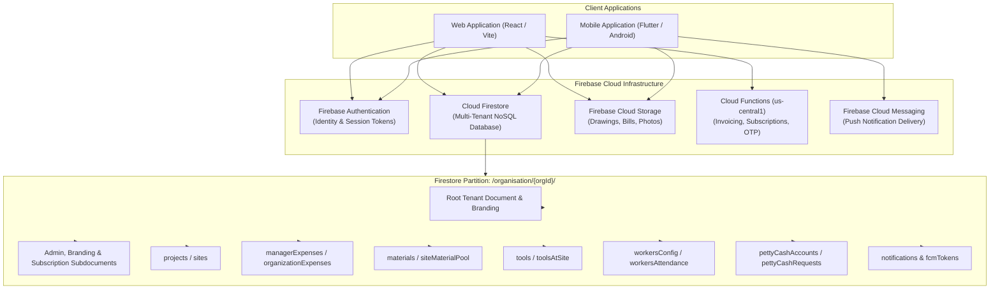
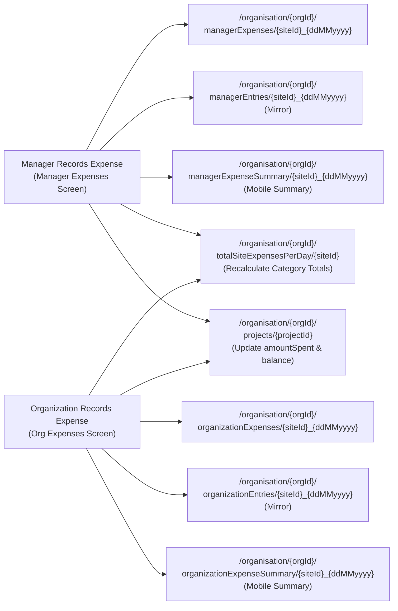

# Firebase Database Structure and Usage Report
**Project:** eBricks (CST White-Label Construction & Operations Platform)  
**Document Version:** 1.0.0  
**Environment:** Production / Staging  
**Backend Platform:** Google Firebase (Cloud Firestore, Firebase Authentication, Firebase Cloud Storage, Firebase Cloud Messaging, Cloud Functions)  
**Date:** October 2026  

---

## Table of Contents
1. [Executive Summary & Architectural Overview](#1-executive-summary--architectural-overview)
2. [Firebase Services Inventory & Configuration](#2-firebase-services-inventory--configuration)
3. [Multi-Tenant Database Hierarchy & Data Partitioning](#3-multi-tenant-database-hierarchy--data-partitioning)
4. [Master Collection & Subcollection Catalog](#4-master-collection--subcollection-catalog)
   - [4.1 Organization Tenancy & Administration](#41-organization-tenancy--administration)
   - [4.2 Subscription, Billing & Quota Governance](#42-subscription-billing--quota-governance)
   - [4.3 Projects, Sites & Stage Configuration](#43-projects-sites--stage-configuration)
   - [4.4 Team, Staff & Workforce Governance](#44-team-staff--workforce-governance)
   - [4.5 Materials, Inventory & Stock Movement](#45-materials-inventory--stock-movement)
   - [4.6 Tools, Machinery & Capital Assets](#46-tools-machinery--capital-assets)
   - [4.7 Vehicle Fleet & Driver Logistics](#47-vehicle-fleet--driver-logistics)
   - [4.8 Architectural Drawings & Blueprints](#48-architectural-drawings--blueprints)
   - [4.9 Financial Management, Ledger & Expenses](#49-financial-management-ledger--expenses)
   - [4.10 Petty Cash Float & Reconciliations](#410-petty-cash-float--reconciliations)
   - [4.11 Daily Site Diary, Progress & Approvals](#411-daily-site-diary-progress--approvals)
   - [4.12 Supervisor Incentives & Performance](#412-supervisor-incentives--performance)
   - [4.13 QA/QC Inspections & HSE Safety Incidents](#413-qaqc-inspections--hse-safety-incidents)
   - [4.14 Push Notifications & Device Tokens](#414-push-notifications--device-tokens)
5. [Module-to-Collection Traceability Matrix](#5-module-to-collection-traceability-matrix)
6. [Cross-Platform Inconsistencies, Mirror Collections & Overlaps](#6-cross-platform-inconsistencies-mirror-collections--overlaps)
7. [Firebase Cloud Storage Structure & File Linkage](#7-firebase-cloud-storage-structure--file-linkage)
8. [Security Rules, Role-Based Access & Data Integrity](#8-security-rules-role-based-access--data-integrity)
9. [Performance Bottlenecks & Strategic Recommendations](#9-performance-bottlenecks--strategic-recommendations)

---

## 1. Executive Summary & Architectural Overview

The **eBricks Construction Management Platform** operates on a multi-tenant, cloud-native Firebase architecture. The database layer is designed to support high-concurrency mobile field operations (Flutter/Android/iOS) alongside an enterprise management web application (React/Vite/Electron).

### Core Architectural Patterns:
1. **Multi-Tenant Hierarchical Isolation:** All operational construction data is isolated under a tenant partition root:  
   `/organisation/{orgId}/...`  
   where `orgId` adheres to the deterministic namespace convention:  
   `cst_{CleanOrganizationName}_{DD-MM-YYYY}` (e.g., `cst_RBConstruction_19-09-2026`).
2. **Dual-Platform Interoperability (Mobile & Web):** The database accommodates schema nuances and query patterns from both the mobile client and the web application. To prevent breaking changes, the platform utilizes canonical collections with fallback aliases and dual-write synchronizations.
3. **Compound Key Determinism:** Documents frequently derive primary keys from natural composite business keys (e.g., `{siteId}_{ddMMyyyy}` or `{projectCode}_{siteCode}_{siteName}`) ensuring idempotent creation and 0ms direct-path document resolution.
4. **Subscription Quota Enforcement:** A software-enforced entitlement layer verifies document limits (projects, managers, supervisors, drawings) in Firestore prior to commits.



---

## 2. Firebase Services Inventory & Configuration

The application initializes and utilizes five discrete Firebase services configured in `src/services/firebase.js`:

| Firebase Service | Project Identifiers & Parameters | Application Usage & Scope |
| :--- | :--- | :--- |
| **Cloud Firestore** | Project ID: `cst-whitelabel-app` | Primary distributed document database holding all relational and operational data. |
| **Firebase Authentication** | Auth Domain: `cst-whitelabel-app.firebaseapp.com`<br>App ID: `1:307172937314:web:ea979720b6a1b637f3cb3b` | Manages user credentials, password hashing, ID token issuance, and multi-tenant storage access contexts. Persistence is set to `browserLocalPersistence`. |
| **Firebase Cloud Storage** | Bucket: `cst-whitelabel-app.firebasestorage.app` | Binary asset repository storing architectural blueprints (`.pdf`, `.dwg`, `.png`), expense bills/vouchers, site photos, and generated export files. |
| **Cloud Functions** | Region: `us-central1`<br>Base URL: `https://us-central1-cst-whitelabel-app.cloudfunctions.net` | Executes privileged backend tasks: OTP email delivery (`requestPasswordResetOtp`), OTP verification (`verifyPasswordResetOtp`), password resets (`completePasswordReset`), tax invoice generation (`sendNewSubscriptionInvoice`), and PayU payment verification (`verifySubscription`). |
| **Firebase Cloud Messaging** | Sender ID: `307172937314` | Dispatches real-time device notifications to field supervisors, site managers, and executive admins. Push tokens are catalogued in `fcmTokens`. |

---

## 3. Multi-Tenant Database Hierarchy & Data Partitioning

### 3.1 Organization Namespace Formula
Every tenant organization document resides in the root collection `organisation`:
- **Document Path:** `/organisation/{orgId}`
- **ID Generation Algorithm:**  
  `orgId = "cst_" + cleanOrgName + "_" + dd-MM-yyyy`  
  *Example:* `cst_RBConstruction_19-09-2026`

### 3.2 Tenant Root & Configuration Subdocuments
Under each `/organisation/{orgId}`, specialized configuration subdocuments store administrative data:

```
/organisation/{orgId}                             [Root Document: App ID, Org Profile, Active Sub Mirror]
    ├── data/
    │    ├── admin                                [Organization Admin Credentials & Identity]
    │    ├── branding                             [App Name, Theme Colors, Branding Palette]
    │    ├── referralCode                         [Assigned 6-Character Referral Code]
    │    └── subscription                         [Authoritative Subscription State, Quotas, Billing]
    ├── admin/
    │    └── data                                 [Legacy Admin Document Mirror]
    └── [Operational Subcollections]              [projects, materials, managerExpenses, etc.]
```

---

## 4. Master Collection & Subcollection Catalog

### 4.1 Organization Tenancy & Administration

#### A. Collection: `/organisation` (Root Document)
- **Purpose:** Primary tenant identity record. Contains organizational profiles, registration metadata, and subscription mirrors.
- **Document ID Format:** `cst_{CleanOrgName}_{DD-MM-YYYY}`
- **User Roles & Modules:** Organization Admin, Public Onboarding Flow.
- **Operations:** Created during registration; read during authentication; updated during branding and profile changes.
- **Query Type:** One-time query on login/registration; real-time listener on active dashboard sessions.

##### Field Schema & Data Types:
```typescript
interface OrganisationRootDoc {
  app_id: string;               // "cst_white_label"
  app_name: string;             // White-label display name (e.g. "eBricks")
  app_type: string;             // "cst_white_label"
  created_at: Timestamp;        // Server creation timestamp
  email: string;                // Corporate email address (e.g. "admin@rbconstruct.com")
  is_cst_app: boolean;          // Strict CST platform identifier (true)
  isSubscriptionActive: boolean;// Master subscription active flag
  onboardingStep: string;       // "COMPLETED" | "PAYMENT_PENDING"
  org_name: string;             // Legal entity name (e.g. "RB Construction")
  password?: string;            // Plaintext password mirror for legacy mobile login
  paymentAmount: number;        // Subscription fee paid (e.g. 0, 1188, 2388)
  paymentGateway: string;       // "PayU" | "None"
  paymentStatus: string;        // "SUCCESS" | "PENDING" | "FAILED"
  phone: string;                // Primary contact number
  referralCode: string;         // 6-digit alphanumeric referral code (e.g. "CST982")
  registrationStatus: string;   // "COMPLETED"
  role: string;                 // "Organization"
  subscriptionPlan: string;     // "Free Trial" | "Silver" | "Gold" | "Platinum"
  subscriptionType: string;     // "Monthly" | "6 Months" | "Yearly" | "Free Trial"
  theme_color: string;          // Hex color code (e.g. "#00A86B")
  updated_at: Timestamp;        // Server last modified timestamp
  username: string;             // Login username
}
```

##### Sample Document:
```json
{
  "app_id": "cst_white_label",
  "app_name": "RB Construction ERP",
  "app_type": "cst_white_label",
  "created_at": "2026-09-19T06:30:00.000Z",
  "email": "director@rbconstruction.in",
  "is_cst_app": true,
  "isSubscriptionActive": true,
  "onboardingStep": "COMPLETED",
  "org_name": "RB Construction",
  "paymentAmount": 2388,
  "paymentGateway": "PayU",
  "paymentStatus": "SUCCESS",
  "phone": "+919876543210",
  "referralCode": "RBC921",
  "registrationStatus": "COMPLETED",
  "role": "Organization",
  "subscriptionPlan": "Gold",
  "subscriptionType": "Yearly",
  "theme_color": "#017FDF",
  "updated_at": "2026-10-29T08:00:00.000Z",
  "username": "rbadmin"
}
```

---

#### B. Subdocument: `/organisation/{orgId}/data/admin`
- **Purpose:** Secure profile storage for executive administrator credentials and contact details.
- **Document ID Format:** Static document ID `admin` under subcollection `data`.
- **User Roles & Modules:** Organization Admin, Authentication Service.
- **Operations:** Created during signup batch; updated during Admin profile edits.
- **Query Type:** One-time lookup on login.

##### Field Schema & Data Types:
```typescript
interface DataAdminDoc {
  app_id: string;         // "cst_white_label"
  is_cst_app: boolean;    // true
  email: string;          // Admin corporate email
  org_name: string;       // Organization name
  password?: string;      // Admin password
  phone: string;          // Contact number
  role: string;           // "Organization"
  username: string;       // Admin username
  created_at: Timestamp;  // Timestamp
}
```

---

#### C. Subcollection: `/organisation/{orgId}/organizationUser`
- **Purpose:** Maintains user account lookup documents keyed directly by username to guarantee global and tenant-level uniqueness.
- **Document ID Format:** `{username}` (lowercase, e.g. `rbadmin`).
- **User Roles & Modules:** Authentication Service, User Governance.
- **Operations:** Create, Read, Delete.

---

### 4.2 Subscription, Billing & Quota Governance

#### A. Subdocument: `/organisation/{orgId}/data/subscription`
- **Purpose:** **Authoritative single source of truth** for organization subscription tier, expiration dates, quotas, and renewal locks.
- **Document ID Format:** Static ID `subscription` under subcollection `data`.
- **User Roles & Modules:** Organization Admin, Subscription Limits Service, Upgrade Modals.
- **Operations:** Created at registration; updated on PayU payment confirmation or plan promotion; read before restricted actions.
- **Query Type:** One-time fetch with real-time listener during active sessions.

##### Field Schema & Data Types:
```typescript
interface DataSubscriptionDoc {
  app_id: string;                         // "cst_white_label"
  subscriptionPlan: string;               // "Free Trial" | "Silver" | "Gold" | "Platinum"
  subscriptionType: string;               // "Monthly" | "6 Months" | "Yearly" | "Free Trial"
  subscriptionStartDate: Timestamp;       // Plan activation start timestamp
  subscriptionEndDate: Timestamp;         // Plan expiration timestamp
  isSubscriptionActive: boolean;          // Active status flag
  onboardingStep: string;                 // "COMPLETED"
  paymentAmount: number;                  // Fee paid in INR
  paymentGateway: string;                 // "PayU" | "None"
  paymentMethod: string;                  // "PayU Gateway" | "Credit Card" | "UPI"
  paymentStatus: string;                  // "SUCCESS" | "PENDING" | "FAILED"
  paymentTxnId: string;                   // Merchant transaction reference ID
  payuMoneyId: string;                    // PayU payment gateway reference ID
  maxProjects: number;                    // Entitled active project site quota (1, 5, 10, etc.)
  maxUsers: number;                       // Entitled administrative user limit
  maxManagers: number;                    // Maximum allowed Manager accounts
  maxSupervisors: number;                 // Maximum allowed Supervisor accounts
  platinumProjects: number | null;        // Additional custom project sites for Platinum tier
  isUpgradeQueued: boolean;               // True if a plan change was scheduled ahead of expiry
  queuedPlan?: string | null;             // Queued upgrade plan name
  queuedPlanType?: string | null;         // Queued billing cycle
  queuedStartDate?: Timestamp | null;     // Start date for queued plan
  queuedEndDate?: Timestamp | null;       // End date for queued plan
  queuedPaymentTxnId?: string | null;     // Transaction ID for queued plan payment
  updatedAt: Timestamp;                   // Timestamp of last quota sync
}
```

##### Sample Document:
```json
{
  "app_id": "cst_white_label",
  "subscriptionPlan": "Gold",
  "subscriptionType": "Yearly",
  "subscriptionStartDate": "2026-09-19T06:30:00.000Z",
  "subscriptionEndDate": "2027-09-19T06:30:00.000Z",
  "isSubscriptionActive": true,
  "onboardingStep": "COMPLETED",
  "paymentAmount": 2388,
  "paymentGateway": "PayU",
  "paymentMethod": "PayU Gateway",
  "paymentStatus": "SUCCESS",
  "paymentTxnId": "PAYU_1758263400000",
  "payuMoneyId": "403993715526",
  "maxProjects": 10,
  "maxUsers": 15,
  "maxManagers": 5,
  "maxSupervisors": 10,
  "platinumProjects": null,
  "isUpgradeQueued": false,
  "updatedAt": "2026-09-19T06:35:00.000Z"
}
```

---

### 4.3 Projects, Sites & Stage Configuration

#### A. Subcollection: `/organisation/{orgId}/projects`
- **Aliases / Fallbacks:** `sites`, `Site`, `Sites`
- **Purpose:** Primary registry for all construction sites, contracts, budgets, financial totals, customer details, and live project statuses.
- **Document ID Format:** Canonical 3-part ID:  
  `{projectCode}_{siteCode}_{CleanSiteName}` (e.g. `PR001_ST001_RiversideResidency`)
- **User Roles & Modules:** Organization Admin (View Only), Site Manager (Full CRUD), Site Supervisor (Assigned Sites).
- **Operations:** Create, Read, Update, Delete.
- **Query Type:** Real-time collection listener (`onSnapshot`) in Project Hub and Manager Dashboard.

##### Field Schema & Data Types:
```typescript
interface ProjectSiteDoc {
  projectId: string;              // Canonical document ID (e.g. "PR001_ST001_RiversideResidency")
  projectCode: string;            // Sequential project code (e.g. "PR001")
  siteId: string;                 // Site identifier (e.g. "ST001_RiversideResidency")
  siteCode: string;               // Sequential site code (e.g. "ST001")
  siteName: string;               // Display name of site
  name: string;                   // Mirror of siteName
  projectName: string;            // Parent project title
  location: string;               // Physical site address or city
  siteLocation: string;           // Mirror of location
  latitude: number | null;        // Geo-coordinate latitude
  longitude: number | null;       // Geo-coordinate longitude

  // Client / Property Owner Information
  ownerName: string;              // Client name (e.g. "Dr. Aris Thorne")
  clientOwnerName: string;        // Mirror of ownerName
  clientName: string;             // Mirror of ownerName
  ownerPhoneNumber: string;       // Client contact number (e.g. "+91 98450 11223")
  clientPhone: string;            // Mirror of ownerPhoneNumber
  clientPhoneNumber: string;      // Mirror of ownerPhoneNumber

  // Financial Budgets & Cash Balances
  projectBudget: number;          // Total contracted project budget
  estimatedBudget: number;        // Mirror of projectBudget
  totalBudget: number;            // Mirror of projectBudget
  budget: number;                 // Mirror of projectBudget
  amountPaid: number;             // Total inflow received from customer
  advancePaid: number;            // Initial customer advance deposit
  amountReceived: number;         // Mirror of amountPaid
  receivedPayments: number;       // Mirror of amountPaid
  amountSpent: number;            // Cumulative expenditure incurred to date
  amountSpend: number;            // Legacy mirror of amountSpent
  totalAmountSpent: number;       // Cumulative expenditure mirror
  spentAmount: number;            // Cumulative expenditure mirror
  amountBalance: number;          // Net cash in hand (amountPaid - amountSpent)
  balance: number;                // Mirror of amountBalance
  balanceAmount: number;          // Customer receivable balance (projectBudget - amountPaid)

  // Classifications & Phase Tracking
  projectCategory: string;        // Master category (e.g. "Residential Construction")
  projectType: string;            // Mirror of projectCategory
  projectSubCategory: string;     // Subcategory (e.g. "Luxury Villa")
  projectContract: string;        // Contract model (e.g. "Turnkey with Material")
  projectContractType: string;    // Mirror of projectContract
  projectStage: string;           // Current construction phase (e.g. "Foundation")
  currentStage: string;           // Mirror of projectStage
  status: string;                 // "Planning" | "In Progress" | "On Hold" | "Completed"
  currentStatus: string;          // Mirror of status
  projectStatus: string;          // Mirror of status
  projectState: string;           // Mirror of status

  // Schedules & Milestone Dates
  startDate: Timestamp;           // Planned inception date
  plannedStartDate: Timestamp;    // Mirror of startDate
  endDate: Timestamp | null;      // Planned completion deadline
  plannedEndDate: Timestamp | null;// Mirror of endDate
  targetEndDate: Timestamp | null;// Mirror of endDate
  actualStartDate: Timestamp | null;// Actual physical commencement date
  actualStateDate: Timestamp | null;// Typo fallback mirror for legacy compatibility
  actualEndDate: Timestamp | null;// Actual physical completion date

  // Subcontracting Metadata
  isContractWork: boolean;        // True if site is outsourced to a general contractor
  contractorName: string | null;  // Subcontractor entity name
  contractorBudget: number | null;// Subcontractor allocated budget

  // Personnel Assignments
  managerId: string;              // Assigned Site Manager ID (e.g. "MG001_sajin")
  managerName: string;            // Site Manager full name
  supervisorId: string;           // Assigned Site Supervisor ID (e.g. "SUP001")
  supervisorName: string;         // Site Supervisor full name

  createdAt: Timestamp;           // Server creation timestamp
  updatedAt: Timestamp;           // Last update timestamp
}
```

##### Sample Document:
```json
{
  "projectId": "PR001_ST001_RiversideResidency",
  "projectCode": "PR001",
  "siteId": "ST001_RiversideResidency",
  "siteCode": "ST001",
  "siteName": "Riverside Residency",
  "name": "Riverside Residency",
  "projectName": "Riverside Residency",
  "location": "Plot 42, Riverfront Road, Kochi",
  "siteLocation": "Plot 42, Riverfront Road, Kochi",
  "latitude": 9.9312,
  "longitude": 76.2673,
  "ownerName": "Dr. Aris Thorne",
  "clientOwnerName": "Dr. Aris Thorne",
  "clientName": "Dr. Aris Thorne",
  "ownerPhoneNumber": "+91 98450 11223",
  "clientPhone": "+91 98450 11223",
  "projectBudget": 15000000,
  "estimatedBudget": 15000000,
  "totalBudget": 15000000,
  "budget": 15000000,
  "amountPaid": 4500000,
  "advancePaid": 2000000,
  "amountReceived": 4500000,
  "amountSpent": 2845000,
  "amountSpend": 2845000,
  "totalAmountSpent": 2845000,
  "spentAmount": 2845000,
  "amountBalance": 1655000,
  "balance": 1655000,
  "balanceAmount": 10500000,
  "projectCategory": "Residential",
  "projectSubCategory": "Luxury Villa",
  "projectContract": "Turnkey with Material",
  "projectStage": "Foundation & Footing Cast",
  "currentStage": "Foundation & Footing Cast",
  "status": "In Progress",
  "currentStatus": "In Progress",
  "startDate": "2026-09-20T00:00:00.000Z",
  "endDate": "2027-08-30T00:00:00.000Z",
  "actualStartDate": "2026-09-25T00:00:00.000Z",
  "isContractWork": false,
  "contractorName": null,
  "contractorBudget": null,
  "managerId": "MG001_sajin",
  "managerName": "Sajin Operations",
  "supervisorId": "SUP001",
  "supervisorName": "Alex Supervisor",
  "createdAt": "2026-09-20T05:30:00.000Z",
  "updatedAt": "2026-10-29T10:15:00.000Z"
}
```

---

#### B. Subcollection: `/organisation/{orgId}/totalSiteExpensesPerDay`
- **Purpose:** Consolidated expense roll-up accumulator maintained per site. Pre-calculates category-level expenditure totals to support real-time finance widgets and mobile summary cards without requiring table scans.
- **Document ID Format:** Canonical site key without project prefix: `{siteCode}_{CleanSiteName}` (e.g. `ST001_RiversideResidency`).
- **User Roles & Modules:** Finance Module, Manager Dashboard, Mobile Telemetry.
- **Operations:** Updated automatically whenever an expense is recorded, edited, or deleted in any expense collection.

##### Field Schema & Data Types:
```typescript
interface TotalSiteExpensesDoc {
  siteId: string;                   // Canonical site ID (e.g. "ST001_RiversideResidency")
  siteCode: string;                 // Site sequence code (e.g. "ST001")
  siteName: string;                 // Display name of site
  totalMgrExpense: number;          // Total cumulative Manager Direct Expenses
  totalOrgExpense: number;          // Total cumulative Organization Direct Expenses
  totalSiteExpense: number;         // Total cumulative Site Supervisor Daily Diary Expenses
  totalContractorExpense: number;   // Total cumulative Subcontractor Claim Disbursements
  totalIncentiveExpenses: number;   // Total Supervisor Performance Cost Savings Incentives
  totalAllExpenses: number;         // Gross sum of all five expense categories
  updatedAt: Timestamp;             // Last recalculated timestamp
  createdAt?: Timestamp;            // Initial creation timestamp
}
```

---

#### C. Subcollection: `/organisation/{orgId}/SitePayment`
- **Aliases / Fallbacks:** `projectPayments`
- **Purpose:** Customer Inflow Ledger tracking customer milestone payments, advances, and client deposits per site.
- **Document ID Format:** Auto-generated Firestore ID or `PAY_{timestamp}`.
- **User Roles & Modules:** Organization Finance, Reports Hub.
- **Operations:** Create, Read, Update, Delete.

##### Field Schema & Data Types:
```typescript
interface SitePaymentDoc {
  id?: string;
  paymentId: string;            // Payment identifier
  siteId: string;               // Target site identifier
  projectId?: string;           // Target project canonical ID
  siteName: string;             // Target site name
  amount: number;               // Inflow payment value received
  paymentDate: Timestamp;       // Date payment was credited
  paymentMethod: string;        // "Bank Transfer" | "Cheque" | "NEFT/RTGS" | "Cash"
  referenceNo: string;          // Bank transaction UTR or Cheque number
  receivedBy: string;           // Person or department receiving inflow
  remarks?: string;             // Payment purpose or stage milestone note
  createdAt: Timestamp;
}
```

---

#### D. Project Master Configuration Subcollections (5 Pillars)
The project architecture defines five configurable metadata subcollections scoped under `/organisation/{orgId}/`:

| Subcollection Name | Doc ID Prefix | Key Fields | Purpose |
| :--- | :--- | :--- | :--- |
| **`projectCategories`** | `PC001`, `PC002` | `projectCategoryId`, `projectCategory` | Master classifications (e.g., Residential, Commercial, Infrastructure). |
| **`projectSubCategories`** | `PSC001`, `PSC002` | `subCategoryId`, `projectSubCategory`, `projectCategory`, `projectCategoryId` | Sub-classifications linked to parent category (e.g., Villa, High-Rise, 2BHK). |
| **`projectStages`** | `PST001`, `PST002` | `projectStageId`, `projectStage` | Milestone construction phases (e.g., Demarcation, Excavation, Foundation, Handover). |
| **`projectContracts`** | `CT001`, `CT002` | `contractId`, `projectContract` | Commercial engagement models (e.g., Item Rate, EPC Turnkey, Labour Contract). |
| **`projectStatus`** *(alias: `projectStatuses`)* | `PSTU001`, `PSTU002` | `projectStatusId`, `projectStatus` | Lifecycle states (e.g., Planning, In Progress, On Hold, Completed). |

---

### 4.4 Team, Staff & Workforce Governance

#### A. Subcollection: `/organisation/{orgId}/manager`
- **Aliases / Fallbacks:** `managers`, `config_users`, `configUsers`
- **Purpose:** Enterprise directory of Site / Operations Managers with authentication credentials and assigned site scopes.
- **Document ID Format:** `MG{seq}_{CleanUsername}` (e.g., `MG001_sajin`).
- **User Roles & Modules:** Organization Admin (Team Management), Manager Authentication.
- **Operations:** Create, Read, Update, Status Toggle (Active/Inactive).
- **Query Type:** Real-time listener in Team Management; queried during Manager login.

##### Field Schema & Data Types:
```typescript
interface ManagerDoc {
  ManagerId: string;          // Formatted ID (e.g. "MG001_sajin")
  managerId: string;          // Lowercase mirror of ManagerId
  UserName: string;           // Unique manager username
  username: string;           // Lowercase mirror of UserName
  FullName: string;           // Legal full name
  fullName: string;           // Lowercase mirror of FullName
  Email: string;              // Official corporate email address
  email: string;              // Lowercase mirror of Email
  ContactNo: string;          // 10-digit mobile number
  phone: string;              // Lowercase mirror of ContactNo
  Department: string;         // Department (default: "Operations")
  Designation: string;        // Designation (default: "Site Manager")
  Password?: string;          // Plaintext credential for Firestore direct auth
  password?: string;          // Lowercase mirror of Password
  Status: string;             // "Active" | "Inactive"
  status: string;             // Lowercase mirror of Status
  orgId: string;              // Organization ID reference
  organizationId: string;     // Mirror of orgId
  assignedSites?: string[];   // Array of siteDocIds the manager oversees
  createdAt: Timestamp;       // Creation timestamp
  updatedAt: Timestamp;       // Last modified timestamp
}
```

---

#### B. Subcollection: `/organisation/{orgId}/supervisor`
- **Aliases / Fallbacks:** `siteSupervisor`, `supervisors`
- **Purpose:** On-site field supervisors registry responsible for daily logs, attendance check-ins, petty cash custody, and material requests.
- **Document ID Format:** Sequential format: `SUP001`, `SUP002`, `SUP003`.
- **User Roles & Modules:** Team Management, Site Assignment, Daily Diaries.
- **Operations:** Create, Read, Update, Deactivate.

##### Field Schema & Data Types:
```typescript
interface SupervisorDoc {
  SupervisorId: string;       // Formatted supervisor ID (e.g. "SUP001")
  supervisorId: string;       // Lowercase mirror of SupervisorId
  FullName: string;           // Supervisor full name
  UserName: string;           // Unique supervisor username
  ContactNo: string;          // 10-digit phone number
  Email: string;              // Email address
  Designation: string;        // "Site Supervisor"
  Photo?: string;             // Base64 or Cloud Storage URL of supervisor avatar
  Password?: string;          // Supervisor mobile app login password
  isActive: boolean;          // Active flag
  status: string;             // "Active" | "Inactive"
  assignedSites: string[];    // Array of assigned site keys
  createdAt: Timestamp;
  updatedAt: Timestamp;
}
```

---

#### C. Subcollection: `/organisation/{orgId}/siteSupervisorMap`
- **Aliases / Fallbacks:** `supervisor_mapping`
- **Purpose:** Represents the formal many-to-many relationship mapping supervisors to specific construction sites with temporal assignment ranges.
- **Document ID Format:** `{siteId}_{CleanSupervisorName}` (e.g. `ST001_RiversideResidency_AlexSupervisor`).

##### Field Schema & Data Types:
```typescript
interface SiteSupervisorMapDoc {
  mappingId: string;          // Document ID
  siteId: string;             // Target site ID
  siteCode: string;           // Target site code (e.g. "ST001")
  siteName: string;           // Display site name
  supervisorId: string;       // Supervisor code (e.g. "SUP001")
  supervisorName: string;     // Supervisor name
  assignedByManagerId: string;// Manager who created allocation
  assignedByManagerName: string;// Manager name
  startDate: string;          // Assignment start date
  endDate: string;            // Target release date
  status: string;             // "Active" | "Relieved"
  createdAt: Timestamp;
}
```

---

#### D. Subcollection: `/organisation/{orgId}/labours`
- **Aliases / Fallbacks:** `labour_categories`
- **Purpose:** Master trade registry defining base daily wages and overtime rates across construction crafts.
- **Document ID Format:** Sequential format: `LT001`, `LT002`, `LT003`.

##### Field Schema & Data Types:
```typescript
interface LabourTradeDoc {
  labourId: string;           // Sequential Trade ID (e.g. "LT001")
  trade: string;              // Trade name (e.g. "Mason", "Carpenter", "Barbender")
  category: string;           // Mirror of trade
  dailyWage: number;          // Standard 8-hour shift wage in INR
  otHourlyRate: number;       // Overtime rate per hour in INR
  status: string;             // "Active"
  createdAt: Timestamp;
  updatedAt: Timestamp;
}
```

---

#### E. Subcollection: `/organisation/{orgId}/workersConfig`
- **Aliases / Fallbacks:** `workers`, `workforce`, `Labour`, `Worker`
- **Purpose:** Comprehensive workforce catalog registering individual field workers, biometric identities, emergency contacts, and assigned trades.
- **Document ID Format:** `WRK{seq}_{CleanWorkerName}` or `WRK001`, `WRK002`.

##### Field Schema & Data Types:
```typescript
interface WorkerDoc {
  workerId: string;           // Worker ID (e.g. "WRK001")
  workerName: string;         // Worker full name
  name: string;               // Mirror of workerName
  phone: string;              // Contact number
  tradeId: string;            // Foreign key to labours collection (e.g. "LT001")
  trade: string;              // Trade name (e.g. "Mason")
  dailyWage: number;          // Customized daily wage override
  otHourlyRate: number;       // Customized overtime rate override
  aadhaarNumber?: string;     // Identification number
  status: string;             // "Active" | "Relieved" | "Blacklisted"
  currentSiteId?: string;     // Active site allocation
  createdAt: Timestamp;
  updatedAt: Timestamp;
}
```

---

#### F. Subcollection: `/organisation/{orgId}/workerSiteMapping`
- **Aliases / Fallbacks:** `workerSiteMap`, `worker_site_mapping`
- **Purpose:** Site-level muster roll manifest listing all workers currently stationed at a specific construction site.
- **Document ID Format:** Target `{siteId}` (e.g. `ST001_RiversideResidency`).

##### Field Schema & Data Types:
```typescript
interface WorkerSiteMappingDoc {
  siteId: string;             // Canonical site ID
  siteName: string;           // Site name
  workers: Array<{            // Array of stationed workers
    workerId: string;         // Worker ID reference
    workerName: string;       // Worker name
    trade: string;            // Trade
    dailyWage: number;        // Rate
    assignedDate: string;     // ISO date
  }>;
  totalWorkersCount: number;  // Headcount stationed at site
  updatedAt: Timestamp;
}
```

---

#### G. Subcollection: `/organisation/{orgId}/workersAttendance`
- **Aliases / Fallbacks:** `workerAttendance`, `worker_attendance`, `muster_roll`, `attendance`
- **Purpose:** Daily shift attendance ledger capturing morning check-in, evening check-out, overtime hours, and daily wage liabilities.
- **Document ID Format:** `{siteId}_{DDMMYYYY}` (e.g. `ST001_RiversideResidency_29102026`).

##### Field Schema & Data Types:
```typescript
interface WorkersDailyAttendanceDoc {
  attendanceId: string;       // Document ID
  siteId: string;             // Site ID
  siteName: string;           // Site name
  date: string;               // Date string (e.g. "2026-10-29")
  ddMMyyyy: string;           // Compact date string (e.g. "29102026")
  supervisorId: string;       // Supervisor marking attendance
  supervisorName: string;     // Supervisor name
  records: Array<{            // Individual attendance records
    workerId: string;         // Worker reference ID
    workerName: string;       // Worker name
    trade: string;            // Trade
    status: string;           // "Present" | "Half Day" | "Absent" | "Overtime Only"
    presentUnits: number;     // 1.0 = Full day, 0.5 = Half day, 0.0 = Absent
    otHours: number;          // Overtime hours worked (e.g. 2.5)
    dailyWage: number;        // Base daily wage applied
    otHourlyRate: number;     // OT hourly rate applied
    totalPayable: number;     // Computed day earnings (presentUnits * dailyWage + otHours * otHourlyRate)
    remarks?: string;         // Task or conduct note
  }>;
  totalPresent: number;       // Headcount present
  totalAbsent: number;        // Headcount absent
  totalDailyWageLiability: number;// Sum of all totalPayable for the day
  createdAt: Timestamp;
  updatedAt: Timestamp;
}
```

---

#### H. Subcollection: `/organisation/{orgId}/WorkerMonthlyAttendance`
- **Aliases / Fallbacks:** `workerMonthlyAttendance`
- **Purpose:** Aggregated monthly payroll ledger per worker, recording month-to-date days worked, overtime hours, and cumulative wage liabilities.
- **Document ID Format:** `{workerId}_{YYYYMM}` (e.g. `WRK001_202610`).

---

#### I. Subcollection: `/organisation/{orgId}/contractors` & `/contractorEntries`
- **`contractors` (Registry):** Subcontractors master catalog.
  - **Document ID:** `CONT_{timestamp}`
  - **Key Fields:** `contractorId`, `contractorName`, `phone`, `projectField`, `trade`, `contractValue`, `advancePaid`, `retentionPercentage`, `status`.
- **`contractorEntries` (Claims & MB Bills):** Measurement book billing claims.
  - **Document ID:** `CENTRY_{timestamp}_{rand}`
  - **Key Fields:** `entryId`, `contractorId`, `contractorName`, `siteId`, `siteName`, `date`, `projectField`, `workDescription`, `measurement`, `amount`, `claimedAmount`, `status` (`pending` | `approved` | `paid`).

---

### 4.5 Materials, Inventory & Stock Movement

#### A. Master Material Metadata Subcollections
1. **`/organisation/{orgId}/materials` (Catalog):**
   - **Document ID:** `MT001`, `MT002`, etc.
   - **Fields:** `materialId`, `materialName`, `category`, `subCategory`, `unit`, `unitPrice`, `reorderLevel`, `currentStock`, `warehouseStock`, `totalStock`, `createdAt`, `updatedAt`.
2. **`/organisation/{orgId}/materialCategories`:**
   - **Document ID:** `MC001`, `MC002` (Fields: `categoryId`, `categoryName`).
3. **`/organisation/{orgId}/materialSubCategories`:**
   - **Document ID:** `MSC001`, `MSC002` (Fields: `subCategoryId`, `subCategoryName`, `category`, `categoryId`).
4. **`/organisation/{orgId}/materialUnits`:**
   - **Document ID:** `MU001`, `MU002` (Fields: `unitId`, `unitName`, `unit`).

---

#### B. Inventory Stock & Site Pool Subcollections
1. **`/organisation/{orgId}/materialsAvailability`:** Central Warehouse Stock Ledger.
   - **Document ID:** Normalized material key `{cleanMaterialName}` (e.g. `cement_53_grade`).
   - **Fields:** `materialName`, `availableQuantity`, `stock`, `unit`, `warehouseLocation`, `lastUpdated`.
2. **`/organisation/{orgId}/siteMaterialPool`:** Site-Level Allocated Stock Ledger.
   - **Document ID:** `{siteId}_{cleanMaterialName}` (e.g. `ST001_Testing_cement_53_grade`).
   - **Fields:** `siteId`, `siteName`, `materialName`, `allocatedQuantity`, `consumedQuantity`, `availableQuantity`, `unit`, `lastUpdated`.
3. **`/organisation/{orgId}/materialMovements` *(alias: `materialTransactions`)*:**
   - **Document ID:** `TXN_MAT_{timestamp}`
   - **Fields:** `txnId`, `type` (`DISPATCH` | `TRANSFER` | `CONSUMPTION`), `fromLocation`, `toLocation`, `materialName`, `quantity`, `unit`, `dispatchedBy`, `receivedBy`, `timestamp`.
4. **`/organisation/{orgId}/siteMaterialsRequest` *(alias: `material_requests`)*:**
   - **Document ID:** `MATREQ_{timestamp}`
   - **Fields:** `requestId`, `siteId`, `siteName`, `materialName`, `quantity`, `unit`, `urgency` (`Normal` | `Critical`), `status` (`Pending` | `Manager Approved` | `Dispatched` | `Rejected`), `supervisorId`, `timestamp`.
5. **`/organisation/{orgId}/materialConsumption` *(alias: `dailyMaterialConsumptions`)*:**
   - **Document ID:** `MATCON_{timestamp}`
   - **Fields:** `consumptionId`, `siteId`, `date`, `materialName`, `consumedQty`, `purpose`, `recordedBy`.

---

### 4.6 Tools, Machinery & Capital Assets

1. **`/organisation/{orgId}/tools` (Catalog):**
   - **Document ID:** `{toolId}_{toolCode}` (e.g. `TC001_Concrete_Mixer_(Org)`).
   - **Fields:** `toolId`, `toolCode`, `toolName`, `category`, `owner` (`Org` | `Rental`), `rentalRatePerDay`, `purchaseCost`, `serialNumber`, `status` (`Available` | `In Use` | `Maintenance`).
2. **`/organisation/{orgId}/toolsAtCompany`:** Central Yard Inventory.
   - **Document ID:** `{toolCode}` (Fields: `toolCode`, `toolName`, `quantityAtCompany`, `lastUpdated`).
3. **`/organisation/{orgId}/toolsAtSite`:** Site Asset Ledger.
   - **Document ID:** `{siteId}_{toolCode}`.
   - **Fields:** `siteId`, `siteName`, `toolCode`, `toolName`, `allocatedQuantity`, `custodianSupervisorId`, `assignedDate`.
4. **`/organisation/{orgId}/toolsMovement` *(alias: `toolMovements`)*:**
   - **Document ID:** `MOV_TOOL_{timestamp}`
   - **Fields:** `movementId`, `toolCode`, `fromSite`, `toSite`, `quantity`, `driverName`, `vehicleNumber`, `status` (`In Transit` | `Delivered`), `timestamp`.
5. **`/organisation/{orgId}/toolsReturn`:** Return documentation when tools are returned to Central Yard.

---

### 4.7 Vehicle Fleet & Driver Logistics

1. **`/organisation/{orgId}/vehicleDetails` (Fleet Registry):**
   - **Document ID:** `VEH_{NormalizedPlateNumber}` (e.g. `VEH_KL07CP8821`).
   - **Fields:** `vehicleId`, `modelName`, `numberPlate`, `registrationNumber`, `vehicleType` (`Tipper`, `JCB`, etc.), `status` (`Active` | `Maintenance`), `assignedDriverName`, `insuranceExpiryDate`, `fcExpiryDate`, `currentOdometer`.
2. **`/organisation/{orgId}/vehicleDrivers` (Driver Roster):**
   - **Document ID:** `DRV_{timestamp}`.
   - **Fields:** `driverId`, `driverName`, `name`, `phone`, `licenseNumber`, `licenseExpiryDate`, `assignedVehicleNumber`, `status`.
3. **`/organisation/{orgId}/vehicleLogs` (Trips & Fuel):**
   - **Document ID:** `VLOG_{timestamp}`.
   - **Fields:** `logId`, `date`, `vehicleNumber`, `numberPlate`, `driverName`, `startingOdometer`, `endingOdometer`, `totalKm`, `dieselLiters`, `dieselCost`, `materialsTransported`, `fromSite`, `toSite`, `recordedBy`.

---

### 4.8 Architectural Drawings & Blueprints

#### A. Subcollection: `/organisation/{orgId}/siteDrawings`
- **Aliases / Fallbacks:** `layoutAndDrawings`, `drawings`, `blueprints`
- **Purpose:** Master repository document grouping all revision drawings for a site on a specific date.
- **Document ID Format:** `DRAWING_{cleanSiteId}_{yyyyMMdd}` (e.g. `DRAWING_ST001_RiversideResidency_20261029`).
- **User Roles & Modules:** Blueprint Hub, Manager Projects, Mobile Field Viewer.
- **Operations:** Create, Read, Update, Delete (subject to subscription drawing quota).

##### Field Schema & Data Types:
```typescript
interface SiteDrawingContainerDoc {
  id: string;                 // Document ID
  docId: string;              // Mirror of id
  siteId: string;             // Canonical site ID (e.g. "ST001_RiversideResidency")
  projectName: string;        // Project name
  supervisorName: string;     // Creator or custodian name
  projectPhase: string;       // Milestone phase (e.g. "Architectural Layout")
  date: string;               // Display date (e.g. "29/10/2026")
  formattedDate: string;      // Hyphenated date (e.g. "29-10-2026")
  totalDocuments: number;     // Number of files attached in siteDocs array
  status: string;             // "Active" | "Archived"
  siteDocs: Array<{           // Array of embedded drawing attachments
    docId: string;            // Sub-document GUID
    docName: string;          // Human-readable title
    purpose: string;          // Architectural, Structural, MEP, etc.
    fileName: string;         // Stored file name
    docUrl: string;           // Firebase Cloud Storage HTTPS download URL
    fileUrl: string;          // Mirror of docUrl
    storagePath: string;      // Firebase Storage absolute path
    fileType: string;         // File extension ("pdf", "dwg", "png")
    fileSizeBytes: number;    // Raw binary byte size
    fileSize: string;         // Human-readable size string ("4.2 MB")
    uploadDate: string;       // Upload date string
    uploadedAt: string;       // ISO 8601 timestamp string
    isCloudUploaded: boolean; // Storage confirmation flag
  }>;
  createdAt: Timestamp;
  updatedAt: Timestamp;
}
```

#### B. Subcollection: `/organisation/{orgId}/siteDrawingsUsage`
- **Purpose:** Tracks per-site drawing quota enforcement (active files, delete counts, reupload counts) per tier.

---

### 4.9 Financial Management, Ledger & Expenses

The financial subsystem relies on **dual-collection mirroring** to guarantee cross-compatibility between the mobile application and the web application.



#### A. Subcollections: `managerExpenses` & `managerEntries`
- **Purpose:** Stores direct expenses incurred by Site Managers (e.g. emergency procurement, site fuel, local hiring).
- **Document ID Format:** Deterministic composite:  
  `{canonicalSiteKey}_{DDMMYYYY}` (e.g. `ST001_RiversideResidency_29102026`).

##### Field Schema & Data Types:
```typescript
interface ManagerExpenseDoc {
  expenseId: string;          // Document ID (e.g. "ST001_RiversideResidency_29102026")
  id: string;                 // Mirror of expenseId
  siteId: string;             // Canonical site key (e.g. "ST001_RiversideResidency")
  siteCode: string;           // Site code ("ST001")
  siteName: string;           // Display site name
  projectName: string;        // Parent project title
  projectStage: string;       // Milestone stage charged
  projectCategory: string;    // Category
  supervisorName: string;     // Supervisor name or ID reference
  managerId: string;          // Manager identity ID (e.g. "MG001_sajin")
  managerName: string;        // Manager name
  raisedBy: string;           // Mirror of managerId
  raisedByName: string;       // Mirror of managerName
  userRole: string;           // "Manager"
  raiserRole: string;         // "Manager"
  expenseDate: Date | Timestamp;// Date expense was incurred
  entryDate: Date | Timestamp;// Record creation date
  date: string;               // ISO date string
  quantity: number | null;    // Total purchased quantity across all bills
  qty: number | null;         // Mirror of quantity
  totalAmount: number;        // Sum of all itemized bills
  amount: number;             // Mirror of totalAmount
  billUrl: string | null;     // Primary bill image download URL
  imageUrl: string | null;    // Mirror of billUrl
  storagePath: string | null; // Primary bill Cloud Storage path
  remarks: string;            // Operational notes
  status: string;             // "recorded" | "approved" | "verified"
  bills: Array<{              // Nested itemized bills array
    billNo: string;           // Vendor invoice number
    vendor: string;           // Vendor / payee business name
    billVendor: string;       // Mirror of vendor
    quantity: number | null;  // Itemized quantity
    qty: number | null;       // Mirror of quantity
    amount: number;           // Bill value in INR
    billAmount: number;       // Mirror of amount
    billCopy: string;         // Download URL or "billURL"
    billUrl: string;          // Download URL
    imageUrl: string;         // Mirror of billUrl
    storagePath: string;      // Firebase Storage path
    billDate: Date;           // Invoice date
    description: string;      // Line item description
    raisedBy: string;         // Manager UID
    raisedByName: string;     // Manager name
    userRole: string;         // "Manager"
    createdAt: Date;
  }>;
  createdAt: Timestamp;
  updatedAt: Timestamp;
}
```

---

#### B. Subcollections: `organizationExpenses` & `organizationEntries`
- **Purpose:** Stores corporate head-office direct expenditures disbursed on behalf of a construction project (e.g., bulk steel dispatch, client municipal approvals, architecture fees).
- **Document ID Format:** Deterministic composite:  
  `{canonicalSiteKey}_{DDMMYYYY}` (e.g. `ST001_RiversideResidency_29102026`).
- **Field Schema:** Identical structure to `managerExpenses`, with `category: "Organization Bill"`, `raiserRole: "Organization"`, and storage references under `/Organization_exp_bill/`.

---

### 4.10 Petty Cash Float & Reconciliations

The Petty Cash engine operates across seven structured collections:

| Collection Name | Document ID Pattern | Primary Purpose & Contents |
| :--- | :--- | :--- |
| **`pettyCashAccounts`** | `{siteId}_{supervisorId}` | Float account master: `currentBalance`, `disbursedTotal`, `spentTotal`, `pendingVouchersTotal`, `status`. |
| **`pettyCashRequests`** | `PCR_{timestamp}_{hash}` | Float top-up workflow ledger (`PENDING_MANAGER_REVIEW` -> `PENDING_ORGANIZATION_APPROVAL` -> `DISBURSED` -> `RECEIVED`). |
| **`pettyCashExpenses`** *(alias: `petty_cash_expenses`, `vouchers`)* | `PCEXP_{timestamp}` | Individual expense vouchers filed by site supervisors with attached receipts, vendor names, and GST details. |
| **`pettyCashTransactions`** | `PCTXN_{timestamp}` | Immutable double-entry financial ledger recording every cash movement (float issue, voucher settlement, cash return). |
| **`pettyCashReconciliations`** | `PCREC_{timestamp}` | Monthly or milestone float settlement statements submitted by supervisors for manager audit. |
| **`pettyCashReturns`** | `PCRET_{timestamp}` | Physical excess cash handed back to company treasury. |
| **`pettyCashAuditLogs`** | Auto-ID | Tamper-evident audit log recording transitions, actors, timestamps, and previous/new state diffs. |

---

### 4.11 Daily Site Diary, Progress & Approvals

#### A. Subcollection: `/organisation/{orgId}/siteSupervisorEntries`
- **Aliases / Fallbacks:** `daily_site_logs`, `site_logs`, `daily_logs`
- **Purpose:** Comprehensive daily site diary recording work progress, material consumption, labour muster, weather conditions, photos, and petty site sundries.
- **Document ID Format:** `{siteCode}_{DDMMYYYY}` (e.g. `ST001_29102026`) or `ENTRY_{timestamp}_{rand}`.

##### Field Schema & Data Types:
```typescript
interface DailySiteSupervisorEntryDoc {
  entryId: string;            // Document ID (e.g. "ST001_29102026")
  siteId: string;             // Canonical site ID
  siteCode: string;           // Site code ("ST001")
  siteName: string;           // Site display name
  date: Timestamp | string;   // Entry date
  ddMMyyyy: string;           // Compact date string
  supervisorId: string;       // Submitting supervisor ID
  supervisorName: string;     // Supervisor name
  weather: string;            // "Sunny / Clear Sky" | "Rainy" | "Cloudy"
  workDescription: string;    // Structural activity summary
  progressPercentage: number; // Estimated stage progress increment
  
  // Embedded Nested Collections:
  materials: Array<{          // Daily material consumption records
    materialName: string;
    quantity: number;
    unit: string;
    unitPrice: number;
    amount: number;
  }>;
  labours: Array<{            // Daily labour muster records
    trade: string;
    headcount: number;
    dailyWage: number;
    totalAmount: number;
  }>;
  siteExpenses: Array<{        // Sundry out-of-pocket expenses
    item: string;
    amount: number;
    receiptUrl?: string;
  }>;
  photos: string[];           // Array of Cloud Storage photo URLs
  totalSiteExpense: number;   // Gross daily operational expenditure sum
  approvalStatus: string;     // "Pending" | "Manager Approved" | "Rejected"
  createdAt: Timestamp;
  updatedAt: Timestamp;
}
```

---

### 4.12 Supervisor Incentives & Performance

To motivate field supervisors to minimize construction wastage and labour overheads, the platform implements an incentive calculation model documented in `incentive_flow.txt`:

1. **`siteSupervisorProjectStageSchedule`:** Scheduled labour days, headcounts, and estimated payment.
   - **Document ID:** `{siteId}_{supervisorName}_{projectStage}`
2. **`siteSupervisorProjectStageActual`:** Actual labour days and actual payments verified upon stage completion.
   - **Document ID:** `{siteId}_{supervisorName}_{projectStage}`
3. **`siteSupervisorIncentives`:** Audit ledger storing confirmed cost savings and computed bonus payout.
   - **Document ID:** `{siteId}_{supervisorName}_{projectStage}`
   - **Key Fields:** `actualAmount`, `approvedAmount`, `savedAmount` (`approvedAmount - actualAmount`), `incentivePercentage` (e.g. 5%), `incentiveAmount` (`savedAmount * incentivePercentage / 100`).

---

### 4.13 QA/QC Inspections & HSE Safety Incidents

1. **`/organisation/{orgId}/quality_checklists`:**
   - **Document ID:** Auto-generated ID.
   - **Fields:** `projectId`, `projectName`, `stage`, `inspectionType` (e.g., *Reinforcement Pre-Pour Inspection*, *Concrete Slump Test*), `inspectedBy`, `inspectionDate`, `items` (checklist items), `snagList`, `status` (`passed` | `failed` | `conditional_pass`), `remarks`.
2. **`/organisation/{orgId}/safety_incidents`:**
   - **Document ID:** Auto-generated ID.
   - **Fields:** `projectId`, `projectName`, `date`, `incidentType` (`Near Miss`, `First Aid`, `Lost Time Injury`), `severity` (`Low`, `Medium`, `Critical`), `description`, `correctiveAction`, `reportedBy`, `status`.

---

### 4.14 Push Notifications & Device Tokens

1. **`/organisation/{orgId}/notifications` *(alias: `alerts`)*:**
   - **Document ID:** Auto-generated ID or `NOTIF_{timestamp}`.
   - **Fields:** `title`, `body`, `type` (`materialRequisition`, `pettyCashRequest`, `managerExpense`, etc.), `role` (`organisation`, `manager`, `supervisor`, `all`), `userId` (recipient UID), `siteId`, `isRead` (boolean), `createdAt`.
2. **`/organisation/{orgId}/fcmTokens`:**
   - **Document ID:** `{canonicalRole}_{userId}` (e.g. `manager_MG001_sajin`).
   - **Fields:** `token` (Firebase Cloud Messaging registration token), `userId`, `userName`, `userType`, `role`, `orgId`, `platform` (`web` | `android` | `ios`), `updatedAt`.

---

## 5. Module-to-Collection Traceability Matrix

| Application Module | Primary Firestore Collections | Supporting / Mirror Collections | Firebase Cloud Storage Subdirectory |
| :--- | :--- | :--- | :--- |
| **Authentication & Onboarding** | `/organisation`<br>`/organisation/{orgId}/data/admin`<br>`/organisation/{orgId}/data/branding`<br>`/organisation/{orgId}/organizationUser` | `admin/data`<br>`data/referralCode`<br>`referralCodes` | N/A |
| **Subscription & Quota Management** | `/organisation/{orgId}/data/subscription` | `/organisation` (root doc)<br>`admin/data`<br>`data/admin` | N/A |
| **Projects & Sites Management** | `/organisation/{orgId}/projects`<br>`/organisation/{orgId}/totalSiteExpensesPerDay` | `sites`, `Site`<br>`siteSupervisorMap`<br>`siteSupervisorProjectStageSchedule` | `/drawings/{siteFolder}/` |
| **Project Master Configurations** | `projectCategories`<br>`projectSubCategories`<br>`projectStages`<br>`projectContracts`<br>`projectStatus` | N/A | N/A |
| **Team & Workforce Management** | `/organisation/{orgId}/manager`<br>`/organisation/{orgId}/supervisor`<br>`/organisation/{orgId}/labours`<br>`/organisation/{orgId}/workersConfig` | `managers`, `config_users`<br>`workers`, `workforce`<br>`workerSiteMapping` | N/A |
| **Field Attendance & Muster Roll** | `/organisation/{orgId}/workersAttendance` | `workerAttendance`<br>`WorkerMonthlyAttendance` | N/A |
| **Contractors & Subcontracting** | `/organisation/{orgId}/contractors`<br>`/organisation/{orgId}/contractorEntries` | `contractor_bills`<br>`contractor_claims` | N/A |
| **Materials & Inventory Hub** | `/organisation/{orgId}/materials`<br>`/organisation/{orgId}/materialsAvailability`<br>`/organisation/{orgId}/siteMaterialPool`<br>`/organisation/{orgId}/materialMovements` | `materialCategories`<br>`materialSubCategories`<br>`materialUnits`<br>`siteMaterialsRequest` | N/A |
| **Tools & Equipment Assets** | `/organisation/{orgId}/tools`<br>`/organisation/{orgId}/toolsAtCompany`<br>`/organisation/{orgId}/toolsAtSite`<br>`/organisation/{orgId}/toolsMovement` | `toolsInventory`<br>`toolsReturn`<br>`siteToolsRequest` | N/A |
| **Vehicle Fleet & Logistics** | `/organisation/{orgId}/vehicleDetails`<br>`/organisation/{orgId}/vehicleDrivers`<br>`/organisation/{orgId}/vehicleLogs` | `vehicles`, `fleet`<br>`vehicle_logs` | N/A |
| **Blueprints & Architectural Drawings** | `/organisation/{orgId}/siteDrawings`<br>`/organisation/{orgId}/siteDrawingsUsage` | `layoutAndDrawings`<br>`drawings`<br>`blueprints` | `/drawings/{siteFolder}/{ts}_{filename}` |
| **Manager Direct Expenses** | `/organisation/{orgId}/managerExpenses`<br>`/organisation/{orgId}/totalSiteExpensesPerDay` | `managerEntries`<br>`managerExpenseSummary`<br>`projects` | `/Manager_exp_bill/{siteFolder}/{ts}_{billNo}_{filename}` |
| **Organization Direct Expenses** | `/organisation/{orgId}/organizationExpenses`<br>`/organisation/{orgId}/totalSiteExpensesPerDay` | `organizationEntries`<br>`organizationExpenseSummary`<br>`projects` | `/Organization_exp_bill/{siteFolder}/{ts}_{billNo}_{filename}` |
| **Organization Finance & Itemized Ledger** | `/organisation/{orgId}/projects`<br>`/organisation/{orgId}/totalSiteExpensesPerDay`<br>`/organisation/{orgId}/SitePayment` | Multi-collection pipeline of all 9 expense streams | `/Organization_exp_bill/`<br>`/Manager_exp_bill/` |
| **Petty Cash Float & Vouchers** | `/organisation/{orgId}/pettyCashAccounts`<br>`/organisation/{orgId}/pettyCashRequests`<br>`/organisation/{orgId}/pettyCashExpenses`<br>`/organisation/{orgId}/pettyCashTransactions` | `petty_cash_expenses`<br>`pettyCashReconciliations`<br>`pettyCashReturns`<br>`pettyCashAuditLogs` | N/A |
| **Daily Site Diaries & Progress** | `/organisation/{orgId}/siteSupervisorEntries` | `daily_site_logs`<br>`site_logs` | `/site_photos/{siteFolder}/` |
| **Supervisor Cost-Savings Incentives** | `/organisation/{orgId}/siteSupervisorIncentives`<br>`/organisation/{orgId}/siteSupervisorProjectStageSchedule`<br>`/organisation/{orgId}/siteSupervisorProjectStageActual` | `totalSiteExpensesPerDay` | N/A |
| **Approvals & Governance Center** | Real-time streams: `siteSupervisorEntries`, `siteMaterialsRequest`, `siteToolsRequest`, `pettyCashRequests`, `contractorEntries` | Dual-audit updates across parent records | N/A |
| **Reports Hub & Analytics** | Aggregation across: `projects`, `SitePayment`, `totalSiteExpensesPerDay`, `managerExpenses`, `organizationExpenses`, `siteSupervisorEntries`, `pettyCashTransactions`, `contractorEntries` | Fallback calculation pipelines | N/A |
| **Push Notifications & Alerting** | `/organisation/{orgId}/notifications`<br>`/organisation/{orgId}/fcmTokens` | `alerts` | N/A |

---

## 6. Cross-Platform Inconsistencies, Mirror Collections & Overlaps

Through systematic static analysis of the codebase, several critical database design challenges, redundant synchronizations, and naming variances were verified.

### 6.1 Multi-Document Subscription Redundancy
When an organization activates a subscription or updates a plan, the data is synchronized across **five separate documents**:
1. `/organisation/{orgId}/data/subscription` *(Authoritative)*
2. `/organisation/{orgId}` *(Root doc mirror)*
3. `/organisation/{orgId}/data/admin` *(Legacy mirror)*
4. `/organisation/{orgId}/admin/data` *(Legacy mirror)*
5. `/organisation/{orgId}/data/data` *(Legacy mirror)*

*Impact:* If a network failure occurs during a batch commit, out-of-sync documents can lead to discrepancies in quota enforcement and subscription status.

### 6.2 Expense Collection Triplication
Recording a single manager expense triggers simultaneous writes to:
1. `managerExpenses/{siteId}_{ddMMyyyy}` (Primary Web record)
2. `managerEntries/{siteId}_{ddMMyyyy}` (Mobile App mirror)
3. `managerExpenseSummary/{siteId}_{ddMMyyyy}` (Daily aggregate rollup)

Similarly, organization expenses are written to:
1. `organizationExpenses/{siteId}_{ddMMyyyy}`
2. `organizationEntries/{siteId}_{ddMMyyyy}`
3. `organizationExpenseSummary/{siteId}_{ddMMyyyy}`

*Impact:* The Itemized Expense Ledger in the Finance module must run complex deduplication algorithms (`seenDocIds`, `seenTransactionIds`) across all nine streams to prevent transactions from being counted and displayed two to three times.

### 6.3 Field Casing & Naming Inconsistencies
Dual mobile/web development introduced disparate naming conventions for identical business concepts:

| Business Metric | Observed Field Variations in Codebase | Resolution Strategy in Services |
| :--- | :--- | :--- |
| **Cumulative Site Expenditure** | `amountSpent`, `amountSpend`, `totalAmountSpent`, `spentAmount` | All four fields are updated simultaneously in `projectService.js` and normalized via `amountValue()`. |
| **Customer Name / Client** | `ownerName`, `clientOwnerName`, `clientName` | Normalized via `extractFieldValue(data, ['ownerName', 'clientOwnerName', 'clientName'])`. |
| **Customer Contact Phone** | `ownerPhoneNumber`, `clientPhone`, `clientPhoneNumber` | Multi-key fallback extractor. |
| **Planned Start Date** | `startDate`, `plannedStartDate` | Evaluates `plannedStartDate || startDate`. |
| **Supervisor Identifier** | `SupervisorId`, `supervisorId`, `Supervisor ID` | Evaluates case variants with regex `/^SUP(\d+)$/i`. |
| **Manager Identifier** | `ManagerId`, `managerId`, `id`, `uid` | Multi-key fallback extractor. |
| **Expense Item Quantity** | `quantity`, `qty`, `billQuantity` | Evaluates `b.quantity ?? b.qty ?? b.billQuantity`. |
| **Bill Attachment Document URL**| `billUrl`, `imageUrl`, `billCopy`, `docUrl`, `fileUrl` | Filters out placeholder token `'billURL'` and selects first valid HTTPS string. |
| **Expense Total Amount** | `totalAmount`, `amount`, `orgExpenseTotalAmount`, `managerExpenseTotalAmount` | Sums itemized `bills` array first; falls back to top-level numeric fields. |

---

## 7. Firebase Cloud Storage Structure & File Linkage

### 7.1 Multi-Tenant Storage Partitioning
All files in the Firebase Cloud Storage bucket `cst-whitelabel-app.firebasestorage.app` are partitioned strictly under the organization path:
```
/organisation/{orgId}/
    ├── drawings/{siteFolder}/{timestamp}_{cleanFileName}
    ├── Organization_exp_bill/{siteFolder}/{timestamp}_{billNo}_{cleanFileName}
    ├── Manager_exp_bill/{siteFolder}/{timestamp}_{billNo}_{cleanFileName}
    └── site_photos/{siteFolder}/{timestamp}_{photoId}.jpg
```

### 7.2 Directory Naming Specifications
- **`{siteFolder}` Resolution:** Matches `{siteCode}_{CleanSiteName}` (e.g. `ST001_Testing`, `ST001_RiversideResidency`). Project code prefixes (e.g. `PR001_`) and forward/backward slashes are automatically sanitized.
- **`{cleanFileName}`:** Whitespace is replaced with underscores, and special characters are stripped.

### 7.3 Storage-to-Firestore Linkage Model
When an asset is uploaded via `AppStorageService`:
1. The binary is committed to the exact storage path with custom metadata (`orgId`, `siteFolder`, `uploadedAt`).
2. The generated HTTPS `downloadUrl` and the relative `storagePath` are saved inside the Firestore document:
   - For drawings: Embedded in the `siteDocs` array (`docUrl`, `fileUrl`, `storagePath`).
   - For expenses: Embedded in the `bills` array (`billUrl`, `imageUrl`, `billCopy`, `storagePath`) and duplicated at document root (`billUrl`, `storagePath`).
3. An in-memory cache (`billUrlCache`) eliminates redundant calls to `getDownloadURL` during active user sessions.

---

## 8. Security Rules, Role-Based Access & Data Integrity

### 8.1 Firebase Cloud Storage Security Rules (`storage.rules`)
```javascript
rules_version = '2';
service firebase.storage {
  match /b/{bucket}/o {
    // Multi-tenant isolation: files are strictly scoped under /organisation/{orgId}/
    match /organisation/{orgId}/{allPaths=**} {
      allow read, write: if request.auth != null;
    }
    // Default deny for all unmapped paths
    match /{allPaths=**} {
      allow read, write: if false;
    }
  }
}
```

#### Security Analysis:
- **Tenant Scope Enforcement:** Requests outside `/organisation/{orgId}/` are blocked.
- **Authentication Requirement:** Anonymous access is blocked.
- **Risk Assessment:** While users must be authenticated (`request.auth != null`), the rule does not check whether `request.auth.token.orgId == orgId`. Because Manager sessions may utilize fallback Firestore passwords without a personal Firebase Auth UID, background tenant authentication (`ensureStorageAuthenticated`) signs in with the organization account to grant storage access. Cross-tenant path enforcement should be added to Firebase custom claims.

### 8.2 Firestore Security Considerations & Collection Groups
1. **Unauthenticated Read Requirements:** Tenant lookup during login requires querying `/organisation` by corporate email, username, or organization name.
2. **`collectionGroup` Restrictions:** Collection group queries (e.g. `collectionGroup('manager')`) require index definitions and matching rules:  
   `match /{path=**}/manager/{managerId} { allow read: if true; }`  
   Without this rule, Firestore rejects collection group queries for unauthenticated visitors. The codebase mitigates this by falling back to direct subcollection scans.

### 8.3 Role-Based Access Control (RBAC) Matrix

| User Role | Organization Profile | Projects & Sites | Team & Users | Inventory & Tools | Manager Expenses | Org Expenses | Approvals Center | Reports Hub |
| :--- | :---: | :---: | :---: | :---: | :---: | :---: | :---: | :---: |
| **Organization Admin** | Full CRUD | Read Only *(View Only)* | Full CRUD | Full CRUD | Full CRUD | Full CRUD | Executive Action | Full Access |
| **Site Manager** | No Access | Full CRUD | Read Supervisors | Manage Transfers | Full CRUD | View Only | Review & Forward | Project Reports |
| **Site Supervisor** | No Access | Assigned Sites | View Assigned | Material Requests | View Only | No Access | Submit Claims | Site Diary |
| **Field Worker** | No Access | Stationed Site | No Access | Tool Custody | No Access | No Access | No Access | No Access |

*Enforcement Note:* In `projectService.js`, `verifyNotOrganizationUser(actor)` enforces that Organization Admins have view-only access to site creation, delegating active construction setup to Operations/Site Managers.

---

## 9. Performance Bottlenecks & Strategic Recommendations

### 9.1 Identified Performance Bottlenecks
1. **Multi-Collection Subscription Load:**  
   The Finance module's `subscribeSiteGranularExpenses` listens to **nine separate collections** simultaneously via real-time listeners. On large sites with thousands of ledger entries, this can consume significant client memory and Firebase read quotas.
2. **Full Collection Scans for Authentication:**  
   When collection groups fail due to missing rules or unauthenticated states, `loginManager` and `isOrgNameUnique` fetch all documents from `/organisation` and scan subcollections in parallel.
3. **Synchronous Multi-Document Writes:**  
   Recording an expense performs sequential writes to `managerExpenses`, `managerEntries`, `managerExpenseSummary`, `totalSiteExpensesPerDay`, and `projects`. If a client disconnects mid-sequence, partial writes may occur.

### 9.2 Strategic Technical Recommendations
1. **Atomic Batch Writes for Expenses:**  
   Encapsulate the five-document expense update sequence within a single Firestore `writeBatch` or `runTransaction` to guarantee all-or-nothing atomicity.
2. **Transition from Duplicate Collections to Role/Category Flags:**  
   Instead of writing to both `managerExpenses` and `managerEntries`, or `organizationExpenses` and `organizationEntries`, maintain a single canonical collection (`expenses`) with a `sourceType` or `expenseType` field (`"Manager Direct"` vs `"Organization Bill"`).
3. **Indexed Query Lookups for Login:**  
   Create targeted composite indexes on `email` and `UserName` across subcollections to eliminate full table scans during authentication.
4. **Cloud Storage Tenant Claims:**  
   Configure Firebase Auth Custom Claims (`token.claims.orgId`) and update `storage.rules`:  
   `allow read, write: if request.auth != null && request.auth.token.orgId == orgId;`  
   This ensures multi-tenant storage isolation at the infrastructure level.
5. **Periodic Rollup Snapshots:**  
   Continue leveraging `totalSiteExpensesPerDay` for top-level financial summaries rather than computing aggregations on the client from raw granular streams.

---

## 10. Document Metadata & Approval Notice

- **Report Compilation:** Complete code-level analysis of `Cst_Web_Application`.
- **Database Status:** Active production multi-tenant database.
- **Precautionary Note:** This document is an architectural analysis report. Per instructions, **no existing collections, schemas, workflows, or source code were modified or deleted during this analysis.** Any future restructuring or database migrations must be planned and approved separately.

