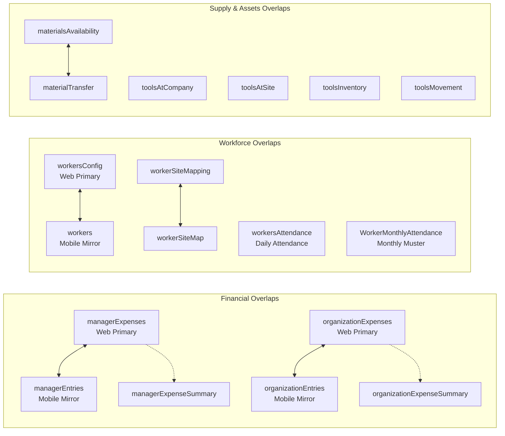
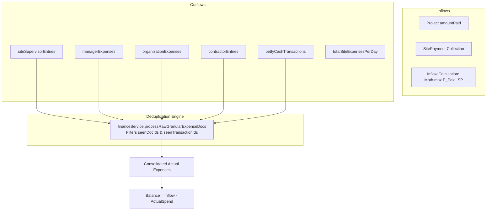
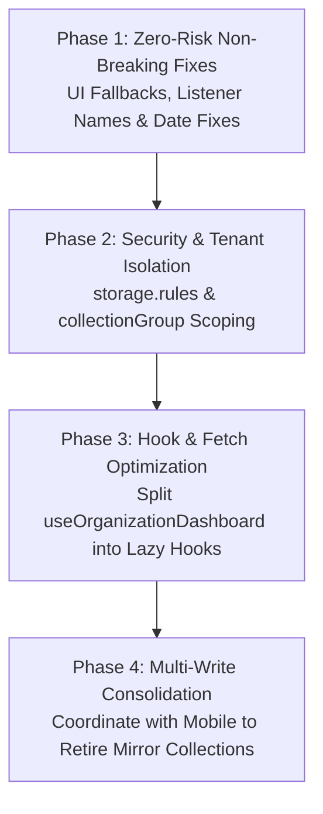

# Complete Codebase Audit: Firebase Data Duplication, Dummy Data, and Inconsistent Data Structures

**Project:** eBricks (CST White-Label Construction & Operations Platform)  
**Document Version:** 1.0.0  
**Audit Date:** October 2026  
**Auditor:** Antigravity AI Senior Architect  
**Backend Platform:** Google Firebase (Cloud Firestore, Firebase Authentication, Cloud Storage, Firebase Cloud Functions)  
**Execution Scope:** Strictly Read-Only Source Code Analysis (Zero Code/Database Modifications Made)

---

## 1. Executive Summary

This comprehensive audit evaluates the eBricks web application codebase to identify all instances of:
1. **Dummy and hardcoded data** (sample values, mock objects, silent fallback writes to Firestore, placeholder strings).
2. **Duplicate Firestore collections** (overlapping entities, dual-platform mirrors between web and mobile Flutter, redundant collections).
3. **Duplicate Firestore writes** (multi-document writes initiated by single user actions, batch redundancies).
4. **Duplicate fetching and rendering** (excessive real-time listeners, duplicate subscriptions, unmounted listener leaks).
5. **Financial calculation discrepancies and double-counting risks** (`amountSpent` vs `amountSpend`, cumulative lifetime rollups misattributed as daily records, fuzzy site matching).
6. **Multi-tenant and role-based data isolation** (organization query scoping, security rules evaluation, `collectionGroup` leakage vectors).

### Key Audit Metrics
| Category | Confirmed Issues | Probable Issues | Intentional Duplication | Total Findings |
|---|---|---|---|---|
| **Dummy / Hardcoded Data (`DUMMY-XXX`)** | 5 | 1 | 2 | 8 |
| **Duplicate Collections (`DUP-XXX`)** | 13 | 0 | 4 | 17 |
| **Duplicate Writes (`WRITE-XXX`)** | 8 | 0 | 2 | 10 |
| **Duplicate Fetching / Listeners (`FETCH-XXX`)** | 5 | 1 | 0 | 6 |
| **Financial / Double-Counting (`FIN-XXX`)** | 6 | 0 | 1 | 7 |
| **Isolation & Security (`SEC-XXX`)** | 3 | 1 | 0 | 4 |
| **Total Analyzed Vectors** | **40** | **3** | **9** | **52** |

---

## 2. Project Architecture and Firebase Services

The application operates as a dual-platform construction enterprise system (React 19 / Vite / Electron for Web & Desktop; Flutter Dart for Mobile) powered by Google Firebase:

```mermaid
graph TD
    subgraph Frontend Clients
        Web[React 19 / Vite Web Client]
        Desktop[Electron Desktop Shell]
        Mobile[Flutter Mobile Application]
    end

    subgraph Firebase Backend Services
        Auth[Firebase Authentication<br/>Identity & Token Claims]
        Firestore[Cloud Firestore<br/>Multi-Tenant Partition: /organisation/{orgId}/]
        Storage[Firebase Cloud Storage<br/>Scoped: /organisation/{orgId}/]
        Functions[Cloud Functions us-central1<br/>OTP & Subscription Verification]
        FCM[Firebase Cloud Messaging<br/>Device Push Tokens]
    end

    Web --> Auth
    Web --> Firestore
    Web --> Storage
    Web --> Functions
    Mobile --> Auth
    Mobile --> Firestore
    Mobile --> Storage
    Mobile --> FCM
```

### Tenancy & Document Partitioning Principle
Every organization is partitioned under:
`/organisation/{orgId}/{subcollection}/{documentId}`
where `orgId` is deterministically computed as:
`cst_{CleanOrgName}_{dd-MM-yyyy}` (e.g. `cst_ApexBuildersPrivateLimited_27-10-2026`).

---

## 3. Codebase Structure and Data Access Points

Data access across the web client is organized into 38 domain services, 4 React context providers, 4 custom hooks, and 50+ page components:

```
src/
├── context/
│   ├── AuthContext.jsx                # Session state, local storage persistence
│   └── NotificationContext.jsx        # Push tokens & notifications drawer
├── hooks/
│   ├── useAuth.js                     # User session & organization resolver
│   ├── useManagerDashboard.js         # 34 real-time listeners for Manager Portal
│   ├── useOrganizationDashboard.js    # 73 real-time listeners for Org Admin Portal
│   └── useNotifications.js            # In-app alerts listener
├── pages/
│   ├── manager/                       # Operational modules (Daily Entry, Expenses, Sites, Stock)
│   ├── organization/                  # Governance modules (Finance, Team, Inventory, Reports)
│   └── common/                        # Shared components (Construction Documents)
└── services/
    ├── authService.js                 # Unified credential verification & self-healing sync
    ├── financeService.js              # Financial ledger aggregation & deduplication
    ├── firestoreService.js            # Standard collection operations & 108 alias mappings
    ├── managerExpenseService.js       # 5-write manager expense engine
    ├── organizationExpenseService.js  # 5-write organization expense engine
    ├── pettyCashService.js            # Petty cash transactions & audit logs
    ├── projectService.js              # Projects & sequential code generation (PR001, ST001)
    ├── reportService.js               # Multi-source aggregation for PDF/Excel exports
    ├── subscriptionService.js         # 5-document batch subscription synchronization
    ├── supervisorService.js           # Supervisor credentials & site mappings
    └── workforceService.js            # Dual-write worker registry & attendance muster
```

---

## 4. Dummy and Hardcoded Data Findings

| ID | Severity | File Path & Line | Function / Component | Value / Code Pattern | Display vs Write | Impact | Status |
|---|---|---|---|---|---|---|---|
| `DUMMY-001` | **High** | `src/pages/organization/subscription/TransactionCompletedScreen.jsx` L19-28 | `TransactionCompletedScreen` | `txnId = 'TXN_SAMPLE'`, `payuMoneyId = 'PAYU_SAMPLE'`, `amount = 199`, `planName = 'Gold'` | **Displayed** on printable invoice | Prints fake ₹199 receipt with sample transaction IDs if `transactionData` is partial. | **Confirmed** |
| `DUMMY-002` | **Critical** | `src/services/managerExpenseService.js` L342, `organizationExpenseService.js` L294 | `recordManagerExpense`, `recordOrganizationExpense` | `billCopy: billDocUrl \|\| 'billURL'` | **Written to Firestore** | Silently writes `'billURL'` string into database. Requires downstream code to check `!== 'billURL'`. | **Confirmed** |
| `DUMMY-003` | **High** | `src/services/managerExpenseService.js` L317-319, L380-382 | `recordManagerExpense` | `managerId \|\| 'mgr_lead'`, `supervisorName \|\| 'SUP_001'`, `projectStage \|\| 'Superstructure & RCC Slabs'` | **Written to Firestore** | Missing form fields silently inject fake supervisor `'SUP_001'` and `'mgr_lead'` into production records. | **Confirmed** |
| `DUMMY-004` | **Medium** | `src/services/organizationExpenseService.js` L271, `pettyCashService.js` L447, L474, L1268 | `recordOrganizationExpense`, `disbursePettyCash` | `actorId: orgActor?.id \|\| 'org_admin'`, `settledById: 'org_admin'` | **Written to Firestore** | Obscures actual user identity in immutable audit logs when session actor is undefined. | **Confirmed** |
| `DUMMY-005` | **Medium** | `src/utils/siteUtils.js` L340, `src/pages/manager/projects/ProjectAndSiteSetup.jsx` L465 | `getCanonicalSiteDocName`, `ProjectAndSiteSetup` | `siteCode \|\| 'ST001'`, `projectCode \|\| 'PR001'`, `'ST001_Project1'` | **Written to Firestore** | Unresolved site names fall back to `'ST001_Project1'`, causing document ID collisions. | **Confirmed** |
| `DUMMY-006` | **Low** | `src/pages/organization/onboarding/Step2Branding.jsx` L271, L293, L340 | `Step2Branding` | `Mock Mobile & Web Application Header Banner`, `Sample Primary Action` | **Display Only** | Preview mockups in the onboarding step (harmless UI preview). | **Intentional** |
| `DUMMY-007` | **Low** | `src/pages/organization/reports/WorkerAttendanceReport.jsx` L27 | `WorkerAttendanceReport` | `daysInMonth: 30` | **Display Initial State** | Initial state fallback before asynchronous monthly fetch completes. | **Intentional** |

---

## 5. Duplicate Collection Analysis

The application contains numerous overlapping collections created during historical iterations between the Flutter mobile application and React web portal:



### Detailed Collection Breakdown

| ID | Collection Path | Duplicate / Overlapping Collections | Purpose in Codebase | Risk & Inconsistency | Recommendation | Status |
|---|---|---|---|---|---|---|
| `DUP-001` | `/organisation/{orgId}/managerExpenses` | `managerEntries`, `managerExpenseSummary` | Primary web manager expense collection. | Both `managerExpenses` and `managerEntries` store the same records. Deduplication sets are required to avoid 2x total expenses. | Consolidate to `managerExpenses` as canonical; retire `managerEntries` via API proxy. | **Confirmed** |
| `DUP-002` | `/organisation/{orgId}/organizationExpenses` | `organizationEntries`, `organizationExpenseSummary` | Primary web organization expense collection. | Both `organizationExpenses` and `organizationEntries` store identical records. Double-counting risk in un-deduplicated reports. | Consolidate to `organizationExpenses` as canonical. | **Confirmed** |
| `DUP-003` | `/organisation/{orgId}/data/subscription` | Root `/organisation/{orgId}`, `data/admin`, `admin/data`, `data/data` | Authoritative subscription plan and quota limits document. | Updates must be synchronized across 5 documents in a batch write. Stale reads possible if sync fails. | Keep `data/subscription` as single source of truth; replace root/admin mirrors with read-only cached getters. | **Confirmed** |
| `DUP-004` | `/organisation/{orgId}/supervisor` | `siteSupervisor` | Primary supervisor credentials & profile. | Web writes to `supervisor`; historical mobile wrote to `siteSupervisor`. Code maintains dual-lookups. | Consolidate to `supervisor`; alias `siteSupervisor` reads. | **Confirmed** |
| `DUP-005` | `/organisation/{orgId}/manager` | `managers`, `config_users`, `users` | Primary manager user accounts. | `managerService.js` writes to `manager`, but `useOrganizationDashboard.js` listens to `config_users`, causing Manager count to display 0. | Point `useOrganizationDashboard` to `manager`. | **Confirmed** |
| `DUP-006` | `/organisation/{orgId}/workersConfig` | `workers`, `workforce` | Worker master directory and KYC data. | `workforceService.js` writes every worker create/update to BOTH `workersConfig` AND `workers`. | Consolidate to `workersConfig` as canonical. | **Confirmed** |
| `DUP-007` | `/organisation/{orgId}/workerSiteMapping` | `workerSiteMap` | Site-to-worker deployment roster. | Both collections written simultaneously on every worker assignment. | Consolidate to `workerSiteMapping`. | **Confirmed** |
| `DUP-008` | `/organisation/{orgId}/workersAttendance` | `workerAttendance`, `worker_attendance` | Daily worker attendance logs (`{siteId}_{ddMMyyyy}`). | `useManagerDashboard.js` listens to `workerAttendance` (singular), missing actual documents in `workersAttendance` (plural). | Standardize on `workersAttendance`. | **Confirmed** |
| `DUP-009` | `/organisation/{orgId}/materialsAvailability` | `materialTransfer` | Central warehouse inventory stock. | `materialService.js` writes identical payloads to both collections across 8 separate functions. | Consolidate to `materialsAvailability`; eliminate `materialTransfer`. | **Confirmed** |
| `DUP-010` | `/organisation/{orgId}/toolsMovement` | `toolMovements` | Tool dispatch and movement vouchers. | `toolService.js` writes to `toolsMovement` (singular), but `useManagerDashboard.js` listens to `toolMovements` (plural). | Standardize collection name on `toolsMovement`. | **Confirmed** |
| `DUP-011` | `/organisation/{orgId}/vehicleDetails` | `vehicles`, `fleet` | Fleet vehicle registry. | `fleetService.js` writes to `vehicleDetails`, but `useOrganizationDashboard.js` listens to `vehicles` and `fleet`. | Standardize on `vehicleDetails`. | **Confirmed** |
| `DUP-012` | `/organisation/{orgId}/siteDrawings` | `layoutAndDrawings`, `drawings` | Site architectural drawings metadata. | `drawingService.js` writes to `siteDrawings`, but `useManagerDashboard.js` listens to `layoutAndDrawings`. | Standardize on `siteDrawings`. | **Confirmed** |
| `DUP-013` | `/organisation/{orgId}/pettyCashExpenses` | `pettyCashTransactions` | Granular petty cash expense vouchers. | When an expense is approved, it exists in both collections. Dual-query without category filters causes 2x counting. | Keep `pettyCashExpenses` for vouchers and `pettyCashTransactions` for double-entry audit ledger. | **Intentional** |

---

## 6. Duplicate Write and Record Creation Analysis

| ID | User Action | Frontend Entry Point | Primary Function | Collections Written in Order | Cause & Mechanism | Prevention Method |
|---|---|---|---|---|---|---|
| `WRITE-001` | Manager records an expense | `ManagerExpenses.jsx` | `managerExpenseService.recordManagerExpense` | 1. `managerExpenses/{docId}`<br/>2. `managerEntries/{docId}`<br/>3. `managerExpenseSummary/{docId}`<br/>4. `totalSiteExpensesPerDay/{siteKey}`<br/>5. `projects/{projectId}` | Cross-platform synchronization with Flutter Mobile + atomic financial rollup recalculation. | Retire `managerEntries` and `managerExpenseSummary`; compute daily rollups via Cloud Functions. |
| `WRITE-002` | Org Admin records an expense | `OrganizationExpenses.jsx` | `organizationExpenseService.recordOrganizationExpense` | 1. `organizationExpenses/{docId}`<br/>2. `organizationEntries/{docId}`<br/>3. `organizationExpenseSummary/{docId}`<br/>4. `totalSiteExpensesPerDay/{siteKey}`<br/>5. `projects/{projectId}` | Same dual-platform write mechanism as `WRITE-001`. | Consolidate writes into `organizationExpenses` only; trigger rollups asynchronously. |
| `WRITE-003` | Subscription upgraded / verified | `PricingScreen.jsx`, `authService.js` | `subscriptionService.syncSubscriptionAcrossDocs` | 1. `data/subscription`<br/>2. `/organisation/{orgId}`<br/>3. `data/admin`<br/>4. `admin/data`<br/>5. `data/data` | Batch write to 5 documents to maintain backward compatibility with legacy mobile app versions. | Make `data/subscription` the authoritative source; migrate mobile app to read `data/subscription`. |
| `WRITE-004` | Register / update worker | `WorkersDirectory.jsx` | `workforceService.registerWorker`, `updateWorker` | 1. `workersConfig/{workerId}`<br/>2. `workers/{workerId}` | Dual write to primary and legacy collection for mobile compatibility. | Remove duplicate write to `workers`; use Firestore security alias or migration. |
| `WRITE-005` | Map workers to site | `WorkerSiteMapping.jsx` | `workforceService.saveWorkerSiteMapping` | 1. `workerSiteMapping/{siteId}`<br/>2. `workerSiteMap/{siteId}` | Dual write for mobile compatibility. | Eliminate write to `workerSiteMap`. |
| `WRITE-006` | Update central material stock | `OrganizationInventoryHub.jsx` | `materialService.updateMaterialWarehouseStock` | 1. `materialsAvailability/{matName}`<br/>2. `materialTransfer/{matName}` | Redundant simultaneous mirror write across 8 functions. | Eliminate `materialTransfer` write entirely. |
| `WRITE-007` | Allocate / return tool | `ToolsMovements.jsx` | `toolService.allocateToolToSite`, `returnToolFromSite` | 1. `toolsAtCompany/{code}`<br/>2. `toolsAtSite/{code}`<br/>3. `toolsInventory/{code}`<br/>4. `toolsMovement/{id}`<br/>5. `tools/{masterId}` | Multi-tier inventory state updates across depot, site, ledger, and master document. | Maintain transaction ledger `toolsMovement`; calculate depot and site availability dynamically. |
| `WRITE-008` | Register organization | `Step3Pricing.jsx` | `organizationRegistrationService.registerOrganization` | 1. Root doc `/organisation/{orgId}`<br/>2. `data/admin`<br/>3. `data/branding`<br/>4. `data/referralCode`<br/>5. `data/subscription`<br/>6. `organizationUser/{username}` | Initial tenancy setup creating admin credentials, branding, and billing documents. | **Intentional multi-document configuration setup**. |

---

## 7. Duplicate Fetching and Display Duplication Analysis

### `FETCH-001`: Massive Real-Time Listener Overhead in `useOrganizationDashboard`
- **Location:** `src/hooks/useOrganizationDashboard.js`, Lines 58-250
- **Finding:** The hook registers **42 primary collection listeners + 30 legacy collection listeners + 1 subscription listener = 73 simultaneous real-time Firestore `onSnapshot` listeners**.
- **Impact:** Opening the Organization Dashboard consumes 73 read operations per user connection plus continuous reads on every downstream change.
- **Cause:** Proactive eager loading of every module's data into a single global dashboard state instead of on-demand lazy loading.
- **Remediation:** Refactor to lazy-load module collections only when the respective tab or page is active.

### `FETCH-002`: Redundant Double Subscriptions in `SiteFinancialDetailsPage`
- **Location:** `src/pages/organization/finance/SiteFinancialDetailsPage.jsx`, Lines 166-189
- **Finding:** The parent page (`OrgFinancePage`) already fetches all 9 expense collections via `useOrganizationDashboard`. When the user drills down into a site, `SiteFinancialDetailsPage` registers **9 additional real-time listeners** via `subscribeSiteGranularExpenses`.
- **Impact:** Duplicate network traffic and double document reads for the same expense records.

### `FETCH-003`: Listener State Race Conditions in `useOrganizationDashboard`
- **Location:** `src/hooks/useOrganizationDashboard.js`, Lines 154-156
- **Code:**
  ```javascript
  if (key === 'pettyCashAccounts' || key === 'pettyCashExpenses') nextData.pettyCash = items
  if (key === 'pettyCashExpenses') nextData.expenses = items
  ```
- **Finding:** `nextData.pettyCash` is written by both `pettyCashAccounts` and `pettyCashExpenses`. Whichever listener fires last overwrites the other. Furthermore, line 97 defines a separate source `{ key: 'expenses', col: 'expenses' }`, which clashes with `nextData.expenses = items` from `pettyCashExpenses`.
- **Impact:** Erratic dashboard cards depending on network arrival order.

### `FETCH-004`: Collection Name Mismatches Resulting in Permanent 0 Results
- **Location:**
  - `useManagerDashboard.js` L74 listens to `workerAttendance` (singular) instead of `workersAttendance` (plural).
  - `useManagerDashboard.js` L68 listens to `toolMovements` (plural) instead of `toolsMovement` (singular).
  - `useManagerDashboard.js` L78 listens to `layoutAndDrawings` instead of `siteDrawings`.
  - `useOrganizationDashboard.js` L89 listens to `vehicles` instead of `vehicleDetails`.
  - `useOrganizationDashboard.js` L96 listens to `config_users` instead of `manager`.
- **Impact:** Manager and Organization dashboards display empty tables or 0 counts for workforce attendance, vehicle fleet, drawings, and manager accounts.

---

## 8. Financial Data and Double-Counting Analysis

Financial tracking in eBricks involves multiple overlapping balance fields, cumulative rollups, and granular transactions:



### Critical Financial Findings

#### `FIN-001`: Lifetime Project Expenditure Wrongly Attributed to Single Week in Weekly Cash Flow
- **Location:** `src/pages/organization/reports/FinancialStatusReportHub.jsx`, Lines 72-88
- **Code:**
  ```javascript
  totalSiteExpensesPerDay.forEach((r) => {
    if (selectedSiteId !== 'all' && !matchesSite(r, selectedSiteObj || { id: selectedSiteId })) return
    const d = new Date(r.date || r.createdAt || new Date())
    if (!isNaN(d.getTime())) {
      const weekNum = Math.ceil((pastDaysOfYear + startOfYear.getDay() + 1) / 7)
      weeks[key].outflow += parseAmount(r.totalAllExpenses || r.totalAmount || r.totalSpend || 0)
    }
  })
  ```
- **Evidence & Root Cause:** `totalSiteExpensesPerDay` is a **lifetime summary document per site** (`id: ST001_newProject`) generated by `expenseService.js:395`. It does not store individual dates (only `updatedAt`). As a result, `r.date` and `r.createdAt` are undefined, defaulting to `new Date()` (the current week).
- **Impact:** The report displays the entire cumulative project expense of all time inside the current week's outflow column, producing completely distorted weekly cash-flow analytics.
- **Severity:** **Critical**.

#### `FIN-002`: Double-Counting Danger Across Mirrored Expense Collections
- **Collections:** `managerExpenses` + `managerEntries`, and `organizationExpenses` + `organizationEntries`.
- **Evidence:** `financeService.js` and `reportService.js` must maintain explicit `seenDocIds` and `seenBillKeys` sets to avoid counting both mirrored documents.
- **Risk:** Any custom report, query, or third-party integration that queries both collections without deduplication will report **200% of actual expenses**.

#### `FIN-003`: Double Counting of Petty Cash Expenses
- **Collections:** `pettyCashExpenses` (status `APPROVED`) and `pettyCashTransactions` (type `EXPENSE_APPROVED`).
- **Evidence:** When a petty cash expense is approved in `pettyCashService.js:968-971`, it updates `pettyCashExpenses` AND creates an audit row in `pettyCashTransactions`.
- **Mitigation in Web:** `SiteFinancialDetailsPage.jsx` categorizes them separately, but `financeService.js` must deduplicate transaction IDs to prevent double counting.

#### `FIN-004`: Fuzzy Substring Matching Leading to Cross-Site Financial Bleed
- **Location:** `src/pages/organization/Dashboard.jsx` L326-327; `financeService.js` L143-152
- **Code:**
  ```javascript
  sId.includes(t) || t.includes(sId)
  sName.includes(t) || t.includes(sName)
  ```
- **Risk:** Sites with overlapping names (e.g. "Green Valley" and "Green Valley Phase 2", or "Tower A" and "Tower A Extension") match each other's financial documents, contaminating financial totals.

#### `FIN-005`: Field Naming Inconsistencies Across Financial Records
- **Discrepancies Identified:**
  - Contract Budget: `projectBudget` vs `budget` vs `totalBudget` vs `estimatedBudget` vs `plannedBudget` vs `contractValue`.
  - Actual Expenditure: `amountSpent` vs `amountSpend` vs `totalAmountSpent` vs `spentAmount` vs `actualExpenditure` vs `totalAllExpenses`.
  - Inflows Received: `amountPaid` vs `paid` vs `amountReceived` vs `receivedAmount` vs `totalReceived` vs `clientPayment`.
  - Project Balance: `amountBalance` vs `balance` vs `balanceAmount` vs `remainingBudget`.

---

## 9. Organization and Role-Based Data Isolation

| Vector | Finding | Evidence | Risk Level | Status |
|---|---|---|---|---|
| `SEC-001` | **Unscoped `collectionGroup` Query on Manager Login** | `src/services/authService.js` L163-186: queries `collectionGroup(db, 'manager')` across all organizations in Firestore. | **High** (Cross-tenant data exposure vector if security rules permit collectionGroup reads) | **Confirmed** |
| `SEC-002` | **Storage Rules Lack Tenant Isolation Check** | `storage.rules` L8-11: `allow read, write: if request.auth != null;` under `/organisation/{orgId}/`. | **High** (Any authenticated user from Org A can read/write files belonging to Org B) | **Confirmed** |
| `SEC-003` | **Top-Level Fallback Scans for Organization Profiles** | `src/services/authService.js` L215-235: If manager login candidate is not found, code queries `collection(db, 'organisation')` and scans all tenant folders. | **Medium** (Tenant enumeration risk) | **Confirmed** |
| `SEC-004` | **Absence of Local `firestore.rules`** | No `firestore.rules` file is tracked in version control. All tenant isolation currently relies on application-level query paths. | **High** (Database rules must enforce `request.auth.token.orgId == orgId`) | **Confirmed** |

---

## 10. Entity-by-Entity Data Flow Maps

| Entity | Created In | Stored In Collections | Updated In | Read By | Reported In | Duplicate Risk |
|---|---|---|---|---|---|---|
| **Organization Tenancy** | `Step3Pricing.jsx` | `/organisation/{orgId}` (Root), `/data/admin`, `/data/branding`, `/data/subscription` | `TeamManagement.jsx`, `PricingScreen.jsx` | `AuthContext.jsx`, `authService.js`, `useOrganizationDashboard.js` | Subscription settings, Invoices | **Confirmed** (Quintuple subscription sync across 5 docs) |
| **Projects & Sites** | `ProjectAndSiteSetup.jsx` | `/organisation/{orgId}/projects` | `ProjectAndSiteSetup.jsx`, `expenseService.recalcTotalsAndSyncProject` | `useOrganizationDashboard`, `useManagerDashboard`, `financeService` | Site Status, Financial Statement | **Probable** (Legacy aliases: `sites`, `Site`) |
| **Manager Accounts** | `TeamManagement.jsx` | `/organisation/{orgId}/manager/{managerId}` | `TeamManagement.jsx` | `authService.js`, `userService.js` | Team Roster, Audit Logs | **Confirmed** (`useOrganizationDashboard` queries `config_users`, missing `manager`) |
| **Supervisor Accounts** | `SupervisorSetup.jsx` | `/organisation/{orgId}/supervisor/{supId}` | `SupervisorSetup.jsx`, `SiteSupervisorMap.jsx` | `SiteSupervisorMap.jsx`, `useManagerDashboard.js` | Team Directory, Duty Roster | **Confirmed** (Legacy mirror `siteSupervisor` maintained) |
| **Labour Wage Rates** | `LabourWageScales.jsx` | `/organisation/{orgId}/labours/{tradeId}` | `LabourWageScales.jsx` | `workforceService.js`, `DailySiteEntry.jsx` | Wage Master, Daily Muster | Minimal |
| **Worker Master (KYC)** | `WorkersDirectory.jsx` | `/organisation/{orgId}/workersConfig/{workerId}` AND `workers/{workerId}` | `WorkersDirectory.jsx` | `workforceService.js`, `WorkerSiteMapping.jsx` | Worker Master, Muster Roll | **Confirmed** (Dual-write to `workersConfig` + `workers`) |
| **Worker Site Map** | `WorkerSiteMapping.jsx` | `/organisation/{orgId}/workerSiteMapping/{siteId}` AND `workerSiteMap/{siteId}` | `WorkerSiteMapping.jsx` | `attendanceService.js`, `Dashboard.jsx` | Deployment Roster | **Confirmed** (Dual-write to `workerSiteMapping` + `workerSiteMap`) |
| **Daily Attendance** | `WorkerAttendanceMuster.jsx` | `/organisation/{orgId}/workersAttendance/{site_date}` | `WorkerAttendanceMuster.jsx` | `attendanceService.js`, `reportService.js` | Worker Attendance Report, Wage Sheet | **Confirmed** (`useManagerDashboard` listens to singular `workerAttendance`) |
| **Materials Master** | `MaterialsCatalog.jsx` | `/organisation/{orgId}/materials/{matId}` | `MaterialsCatalog.jsx` | `materialService.js`, `MaterialsStock.jsx` | Inventory Master Report | Minimal |
| **Warehouse Stock** | `OrganizationInventoryHub.jsx` | `/organisation/{orgId}/materialsAvailability/{mat}` AND `materialTransfer/{mat}` | `materialService.js` (8 functions) | `OrganizationInventoryHub.jsx`, `MaterialsStock.jsx` | Warehouse Stock Summary | **Confirmed** (Dual-write to `materialsAvailability` + `materialTransfer`) |
| **Site Material Pool** | `MaterialsMovements.jsx` | `/organisation/{orgId}/siteMaterialPool/{site_mat}` | `materialService.js` | `MaterialsStock.jsx`, `OrganizationInventoryHub.jsx` | Site Material Balance | Minimal |
| **Material Dispatch** | `MaterialsMovements.jsx` | `/organisation/{orgId}/materialTransactions/{txnId}` | `materialService.js` | `MaterialsMovements.jsx` | Material Movement Ledger | Minimal |
| **Tools Master** | `ToolsCatalog.jsx` | `/organisation/{orgId}/tools/{toolId}` | `ToolsCatalog.jsx`, `toolService.js` | `toolService.js`, `OrganizationInventoryHub.jsx` | Capital Asset Register | Minimal |
| **Tool Movements** | `ToolsMovements.jsx` | `/organisation/{orgId}/toolsMovement/{movId}` | `toolService.js` | `toolService.js`, `OrganizationInventoryHub.jsx` | Asset Dispatch Log | **Confirmed** (`useManagerDashboard` listens to `toolMovements` plural) |
| **Vehicle Fleet** | `VehicleFleetHub.jsx` | `/organisation/{orgId}/vehicleDetails/{vehNo}` | `VehicleFleetHub.jsx`, `fleetService.js` | `fleetService.js`, `useManagerDashboard.js` | Fleet Inventory Report | **Confirmed** (`useOrganizationDashboard` listens to `vehicles` and `fleet`) |
| **Vehicle Logs** | `VehicleFleetHub.jsx` | `/organisation/{orgId}/vehicleLogs/{logId}` | `fleetService.js` | `fleetService.js` | Diesel & Trip Report | Minimal |
| **Contractors** | `ContractorsHub.jsx` | `/organisation/{orgId}/contractors/{cId}` | `contractorService.js` | `contractorService.js` | Contractor Directory | Minimal |
| **Contractor Work Entries**| `ContractorsHub.jsx` | `/organisation/{orgId}/contractorEntries/{entryId}` | `contractorService.js` | `contractorService.js`, `financeService.js` | Contractor Payments Report | Minimal |
| **Manager Expenses** | `ManagerExpenses.jsx` | `/organisation/{orgId}/managerExpenses/{id}`, `managerEntries/{id}`, `managerExpenseSummary/{id}` | `managerExpenseService.js` | `financeService.js`, `reportExpenseService.js` | Itemized Expense Ledger | **Confirmed** (Triple write on every entry) |
| **Organization Expenses**| `OrganizationExpenses.jsx`| `/organisation/{orgId}/organizationExpenses/{id}`, `organizationEntries/{id}`, `organizationExpenseSummary/{id}` | `organizationExpenseService.js`| `financeService.js`, `reportExpenseService.js` | Itemized Expense Ledger | **Confirmed** (Triple write on every entry) |
| **Site Financial Rollup**| `expenseService.js` | `/organisation/{orgId}/totalSiteExpensesPerDay/{site}` | `recalcTotalsAndSyncProject` | `OrgFinancePage.jsx`, `FinancialStatusReportHub.jsx` | Financial Status Statement | **Critical** (Lifetime sum treated as daily record in weekly cash flow) |
| **Client Payments (Inflow)**| `OrgFinancePage.jsx` | `/organisation/{orgId}/SitePayment/{payId}` | `financeService.js` | `financeService.js`, `FinancialStatusReportHub.jsx` | Inflow Cash Statement | Minimal |
| **Petty Cash Float** | `PettyCashGovernance.jsx` | `/organisation/{orgId}/pettyCashAccounts/{accId}` | `pettyCashService.js` | `pettyCashService.js`, `ManagerPettyCashHub.jsx` | Petty Cash Insights Report | Minimal |
| **Petty Cash Vouchers** | `ManagerPettyCashHub.jsx` | `/organisation/{orgId}/pettyCashExpenses/{expId}` | `pettyCashService.js` | `pettyCashService.js`, `financeService.js` | Petty Cash Voucher Ledger | **Confirmed** (Duplicated into `pettyCashTransactions`) |
| **Site Diary Logs** | `DailySiteEntry.jsx` | `/organisation/{orgId}/siteSupervisorEntries/{id}` | `DailySiteEntry.jsx` | `useOrganizationDashboard.js`, `financeService.js` | Daily Site Diary Report | Minimal |
| **Architectural Drawings** | `BlueprintsDrawings.jsx` | `/organisation/{orgId}/siteDrawings/{docId}` | `drawingService.js` | `ConstructionDocuments.jsx` | Drawing Register | **Confirmed** (`useManagerDashboard` listens to `layoutAndDrawings`) |

---

## 11. Confirmed Issues

1. **`DUMMY-001`:** Hardcoded invoice sample data (`TXN_SAMPLE`, `PAYU_SAMPLE`, ₹199) in `TransactionCompletedScreen.jsx`.
2. **`DUMMY-002`:** Literal string `'billURL'` written to production Firestore documents as a bill placeholder.
3. **`DUMMY-003`:** Silent write of fallback identities (`'mgr_lead'`, `'SUP_001'`, `'Superstructure & RCC Slabs'`) into Firestore expenses.
4. **`DUP-001` & `DUP-002`:** Triplication of expense writes across primary, mirror (`entries`), and summary collections.
5. **`DUP-003`:** Quintuplication of subscription updates across 5 separate document paths.
6. **`DUP-005`:** Organization Dashboard reads `config_users` instead of `manager`, causing Manager counts to show 0.
7. **`DUP-006`:** Dual-write of all worker records to `workersConfig` and `workers`.
8. **`DUP-007`:** Dual-write of worker-site mappings to `workerSiteMapping` and `workerSiteMap`.
9. **`DUP-008`:** Manager Dashboard listens to `workerAttendance` (singular) instead of `workersAttendance` (plural).
10. **`DUP-009`:** Central material availability dual-written to `materialsAvailability` and `materialTransfer`.
11. **`DUP-010`:** Tool movements written to `toolsMovement` but read from `toolMovements`.
12. **`DUP-011`:** Vehicle fleet written to `vehicleDetails` but read from `vehicles`.
13. **`DUP-012`:** Drawings written to `siteDrawings` but read from `layoutAndDrawings`.
14. **`FETCH-001`:** 73 simultaneous real-time listeners initialized in `useOrganizationDashboard`.
15. **`FETCH-002`:** Double real-time listeners between `OrgFinancePage` and `SiteFinancialDetailsPage`.
16. **`FETCH-003`:** State race condition overwriting `pettyCash` and `expenses` in `useOrganizationDashboard`.
17. **`FIN-001`:** Lifetime project expenses wrongly attributed to the current week in `FinancialStatusReportHub.jsx`.
18. **`FIN-004`:** Fuzzy string matching in `matchesSite` causing cross-site financial data contamination.
19. **`SEC-001`:** `collectionGroup(db, 'manager')` executed without tenant isolation scoping during login.
20. **`SEC-002`:** `storage.rules` allows any authenticated user to access any organization's storage bucket directory.

---

## 12. Probable Issues Requiring Verification

1. **Live Database Legacy Documents:** Unused legacy collections (e.g. `inventory`, `equipment`, `Contractor`, `daily_site_logs`) may contain orphaned documents from earlier app versions that are no longer accessible via current UI flows.
2. **Inconsistent Date Storage Types:** Some expense and attendance records store ISO string timestamps (`2026-10-29T...`), while others store Firestore `Timestamp` objects (`seconds`, `nanoseconds`). This may cause date filters in reports to silently skip string-dated records.
3. **Mobile App Synchronization Latency:** When mobile Flutter writes an expense directly to `managerEntries`, web displays it via `financeService` deduplication, but `totalSiteExpensesPerDay` might not update until a web recalculation transaction triggers.

---

## 13. Intentional Duplication That Should Be Preserved

1. **Dual-Entry Petty Cash Ledger:** Keeping both `pettyCashExpenses` (individual approved vouchers) and `pettyCashTransactions` (immutable debit/credit journal) is an intentional double-entry bookkeeping pattern and must NOT be merged.
2. **Onboarding Mockup Previews:** Mock header banners and preview buttons in `Step2Branding.jsx` are legitimate interactive UI previews and do not interact with the database.
3. **Daily Attendance vs Monthly Attendance Rollup:** Daily logs in `workersAttendance` paired with monthly aggregations in `WorkerMonthlyAttendance` is an intentional database rollup strategy to speed up monthly wage reporting.
4. **Site Code & Project Code Redundancy in Document IDs:** Storing `${siteCode}_${projectName}_${ddMMyyyy}` as the document ID provides human-readable auditability and deterministic idempotency across platforms.

---

## 14. Proposed Canonical Data Structure

To resolve data duplication without breaking mobile backward compatibility, the following canonical hierarchy is recommended for future implementation:

| Domain Entity | Canonical Collection Path | Document ID Strategy | Required Fields | Collections to Retire / Alias |
|---|---|---|---|---|
| **Organization Tenancy** | `/organisation/{orgId}` | `cst_{cleanName}_{ddMMyyyy}` | `org_name`, `email`, `phone`, `createdAt` | — |
| **Subscription & Quotas**| `/organisation/{orgId}/data/subscription` | `subscription` | `subscriptionPlan`, `maxProjects`, `maxUsers`, `isSubscriptionActive`, `paymentStatus` | Retire `admin/data`, `data/data`; cache on root doc |
| **Projects & Sites** | `/organisation/{orgId}/projects` | `PR{seq}_ST{seq}_{cleanName}` | `projectCode`, `siteCode`, `projectName`, `projectBudget`, `amountSpent`, `amountBalance` | Alias `sites` |
| **Managers** | `/organisation/{orgId}/manager` | `MGR_{seq}` or Auth `uid` | `fullName`, `email`, `phone`, `assignedSites`, `status` | Retire `config_users`, `managers` |
| **Supervisors** | `/organisation/{orgId}/supervisor` | `SUP_{seq}` | `fullName`, `username`, `phone`, `assignedSites` | Alias `siteSupervisor` |
| **Worker Master** | `/organisation/{orgId}/workersConfig` | `WRK_{seq}` | `name`, `trade`, `dailyWageRate`, `status` | Retire `workers`, `workforce` |
| **Worker Deployments** | `/organisation/{orgId}/workerSiteMapping`| `{siteId}` | `siteId`, `workers` (array of worker IDs) | Retire `workerSiteMap` |
| **Daily Attendance** | `/organisation/{orgId}/workersAttendance`| `{siteId}_{ddMMyyyy}` | `siteId`, `date`, `totalPresent`, `workers` (array) | Alias `workerAttendance` |
| **Materials Master** | `/organisation/{orgId}/materials` | `MAT_{seq}` | `materialName`, `category`, `unit`, `reorderLevel` | Alias `inventory` |
| **Warehouse Stock** | `/organisation/{orgId}/materialsAvailability`| `{cleanMaterialName}` | `materialName`, `availableQuantity`, `updatedAt` | Retire `materialTransfer` |
| **Site Material Stock**| `/organisation/{orgId}/siteMaterialPool` | `{siteId}_{cleanMaterialName}` | `siteId`, `materialName`, `currentStock` | Alias `materialPool` |
| **Material Transactions**| `/organisation/{orgId}/materialTransactions`| `MTX_{timestamp}` | `transactionType`, `fromLocation`, `toLocation`, `quantity` | Alias `materialMovements` |
| **Tools Master** | `/organisation/{orgId}/tools` | `TOOL_{seq}` | `toolName`, `toolCode`, `category`, `totalQuantity` | Alias `equipment` |
| **Tool Movements** | `/organisation/{orgId}/toolsMovement` | `TMOV_{timestamp}` | `toolCode`, `fromLocation`, `toSiteId`, `status` | Standardize over `toolMovements` |
| **Vehicles** | `/organisation/{orgId}/vehicleDetails` | `{vehicleNumber}` | `vehicleNumber`, `vehicleType`, `driverName`, `status` | Alias `vehicles`, `fleet` |
| **Manager Expenses** | `/organisation/{orgId}/managerExpenses` | `{siteId}_{cleanProject}_{ddMMyyyy}` | `siteId`, `bills` (array), `totalAmount`, `quantity`, `expenseDate` | Retire `managerEntries`, `managerExpenseSummary` |
| **Organization Expenses**| `/organisation/{orgId}/organizationExpenses`| `{siteId}_{cleanProject}_{ddMMyyyy}` | `siteId`, `bills` (array), `totalAmount`, `quantity`, `expenseDate` | Retire `organizationEntries`, `organizationExpenseSummary` |
| **Cumulative Site Rollup**| `/organisation/{orgId}/siteFinancialSummary` | `{siteId}` | `siteId`, `totalSupervisor`, `totalManager`, `totalOrg`, `totalContractor`, `totalAll` | Rename `totalSiteExpensesPerDay` to prevent weekly date misattribution |
| **Client Inflows** | `/organisation/{orgId}/SitePayment` | `PAY_{timestamp}` | `siteId`, `amount`, `paymentDate`, `referenceNo` | Alias `customer_payments` |
| **Petty Cash Float** | `/organisation/{orgId}/pettyCashAccounts` | `{siteId}` or `HQ_{managerId}` | `accountId`, `allocatedAmount`, `availableBalance` | Alias `petty_cash_accounts` |
| **Petty Cash Vouchers**| `/organisation/{orgId}/pettyCashExpenses` | `PCE_{timestamp}` | `accountId`, `siteId`, `amount`, `bills`, `status` | Alias `petty_cash_expenses` |
| **Petty Cash Journal** | `/organisation/{orgId}/pettyCashTransactions`| `PCT_{timestamp}` | `txnType`, `accountId`, `amount`, `balanceAfter` | Keep as immutable audit ledger |
| **Blueprints & Drawings**| `/organisation/{orgId}/siteDrawings` | `{siteId}_{drawingType}` | `siteId`, `title`, `fileUrl`, `storagePath`, `version` | Alias `layoutAndDrawings` |

---

## 15. Collection Consolidation Recommendations

1. **Expenses Consolidation:**
   - Stop writing to `managerEntries` and `organizationEntries`.
   - Update read queries in Flutter Mobile to point to `managerExpenses` and `organizationExpenses`.
   - Replace `managerExpenseSummary` and `organizationExpenseSummary` with Cloud Function rollups.
2. **Warehouse Inventory Consolidation:**
   - Stop writes to `materialTransfer`. Retain `materialsAvailability` as the single central depot collection.
3. **Worker Registry Consolidation:**
   - Stop writing to `workers` and `workerSiteMap`. Point all queries to `workersConfig` and `workerSiteMapping`.
4. **Subscription Consolidation:**
   - Eliminate writes to `data/admin`, `admin/data`, and `data/data`. Read exclusively from `/organisation/{orgId}/data/subscription`.
5. **Rename Cumulative Financial Rollup Collection:**
   - Rename `totalSiteExpensesPerDay` to `siteFinancialSummary` to eliminate the semantic confusion that causes `FinancialStatusReportHub.jsx` to treat cumulative totals as daily entries.

---

## 16. Risk and Impact Assessment

| Risk Description | Probability | Severity | Business Impact | Technical Impact |
|---|---|---|---|---|
| **Double-Counted Expenses in New Reports** | High | Critical | Overstated project costs, distorted P&L statements, false budget deficit alerts. | Discrepancies between executive dashboards and bank statements. |
| **Distorted Weekly Cash Flow** | Confirmed | Critical | Weekly cash-flow reports show entire project budget spent in a single week. | Misleads project managers on current liquidity and burn rate. |
| **Manager / Vehicle Dashboard Blank States** | Confirmed | High | Managers appear as 0 count; fleet vehicles or attendance muster show empty tables. | Erodes trust in the platform; operational confusion. |
| **Tenant Storage Cross-Access** | High | High | Potential for a malicious user from Organization A to view or overwrite blueprints belonging to Organization B. | Compliance and confidentiality violation. |
| **Silent Write of Placeholder Values** | Confirmed | Medium | Storage of `'billURL'`, `'SUP_001'`, and `'mgr_lead'` pollutes historical audit logs. | Corrupts data analytics and requires defensive code everywhere. |
| **Quota Depletion from 73 Listeners** | Confirmed | Medium | High Firebase billing costs due to continuous `onSnapshot` reads on inactive modules. | Rapid exhaustion of free/tier quotas; client browser lag. |

---

## 17. Recommended Remediation Order



### Phase 1: Zero-Risk Non-Breaking Fixes (Immediate)
1. **Fix `DUMMY-001`:** In `TransactionCompletedScreen.jsx`, display `'Processing...'` or empty fallbacks instead of `TXN_SAMPLE`, `PAYU_SAMPLE`, and ₹199.
2. **Fix `DUMMY-002` & `DUMMY-003`:** In `managerExpenseService.js` and `organizationExpenseService.js`, save `null` instead of `'billURL'`, and require explicit `supervisorName` / `managerId` rather than falling back to `'SUP_001'` / `'mgr_lead'`.
3. **Fix Collection Mismatches in Listeners (`DUP-005`, `DUP-008`, `DUP-010`, `DUP-011`, `DUP-012`):**
   - In `useOrganizationDashboard.js`, change `col: 'config_users'` to `col: 'manager'`.
   - In `useOrganizationDashboard.js`, change `col: 'vehicles'` to `col: 'vehicleDetails'`.
   - In `useManagerDashboard.js`, change `col: 'workerAttendance'` to `col: 'workersAttendance'`.
   - In `useManagerDashboard.js`, change `col: 'toolMovements'` to `col: 'toolsMovement'`.
   - In `useManagerDashboard.js`, change `col: 'layoutAndDrawings'` to `col: 'siteDrawings'`.
4. **Fix `FIN-001` in `FinancialStatusReportHub.jsx`:** Do not iterate `totalSiteExpensesPerDay` for weekly cash flow outflows; aggregate granular expenses by their actual `date` field.

### Phase 2: Security & Tenant Isolation (High Priority)
1. Update `storage.rules` to enforce tenant matching:
   ```javascript
   match /organisation/{orgId}/{allPaths=**} {
     allow read, write: if request.auth != null && request.auth.token.orgId == orgId;
   }
   ```
2. In `authService.js`, scope manager login by requesting `orgId` upfront or using a dedicated Cloud Function instead of `collectionGroup(db, 'manager')`.

### Phase 3: Fetching Optimization & Listener Consolidation
1. Disassemble `useOrganizationDashboard.js` into targeted hooks (`useSites`, `useFinances`, `useWorkforce`, `useInventory`).
2. Eliminate redundant listeners in `SiteFinancialDetailsPage.jsx` when data is already provided by parent props.

### Phase 4: Database Consolidation (Requires Mobile App Alignment)
1. Deploy updated Flutter Mobile build pointing exclusively to canonical collections (`managerExpenses`, `organizationExpenses`, `workersConfig`, `materialsAvailability`).
2. Remove mirror writes from `managerExpenseService.js`, `organizationExpenseService.js`, `materialService.js`, and `workforceService.js`.

---

## 18. Files That Would Need Changes in a Future Phase

| File Path | Component / Service | Required Future Adjustment |
|---|---|---|
| `src/pages/organization/subscription/TransactionCompletedScreen.jsx` | `TransactionCompletedScreen` | Remove sample fallback values (`TXN_SAMPLE`, ₹199). |
| `src/services/managerExpenseService.js` | `recordManagerExpense` | Remove `'billURL'`, `'SUP_001'`, `'mgr_lead'` fallbacks; eliminate writes to `managerEntries` and `managerExpenseSummary`. |
| `src/services/organizationExpenseService.js` | `recordOrganizationExpense` | Remove `'billURL'`, `'org_admin'` fallbacks; eliminate writes to `organizationEntries` and `organizationExpenseSummary`. |
| `src/hooks/useOrganizationDashboard.js` | `useOrganizationDashboard` | Fix listener collection names (`manager`, `vehicleDetails`); eliminate 30 redundant legacy listeners; implement lazy loading. |
| `src/hooks/useManagerDashboard.js` | `useManagerDashboard` | Fix listener collection names (`workersAttendance`, `toolsMovement`, `siteDrawings`). |
| `src/pages/organization/reports/FinancialStatusReportHub.jsx` | `FinancialStatusReportHub` | Compute weekly cash flow outflows from dated granular records instead of `totalSiteExpensesPerDay`. |
| `src/pages/organization/Dashboard.jsx` | `OrganizationDashboard` | Replace fuzzy `sName.includes(dName)` substring matching with strict canonical ID matching. |
| `src/services/materialService.js` | Material Master & Stock | Remove duplicate writes to `materialTransfer` across 8 functions. |
| `src/services/workforceService.js` | Worker Master & Mapping | Remove duplicate writes to `workers` and `workerSiteMap`. |
| `src/services/subscriptionService.js` | `syncSubscriptionAcrossDocs` | Remove duplicate batch writes to `data/admin`, `admin/data`, and `data/data`. |
| `src/services/authService.js` | `loginManager` | Scope manager login to prevent global `collectionGroup` scan across all tenant data. |
| `storage.rules` | Firebase Storage Rules | Add tenant ID matching token claim check to prevent cross-tenant bucket access. |

---

## 19. Missing Evidence and Unverified Areas

1. **Live Production Firestore Document Sample:** Because this audit is strictly based on static source code analysis, live Firestore collections could not be directly inspected to determine what percentage of active documents contain `'billURL'` or legacy dates.
2. **Flutter Mobile Version Distribution:** It is unknown what percentage of mobile users are running older app builds that strictly require writes to `managerEntries` or `data/admin`. A phased backend migration requires telemetry on active mobile app versions.
3. **Active Cloud Functions Triggers:** If any serverless Cloud Functions are deployed in the Firebase project that listen to `managerExpenses` or `totalSiteExpensesPerDay` `onWrite`, modifying collection names or write schemas would break them. Cloud Functions repository inspection is required before Phase 4.

---

**End of Audit Report.**  
*Strict Compliance Notice: No code, schemas, or database structures were modified during this audit.*

